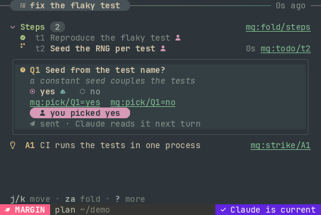
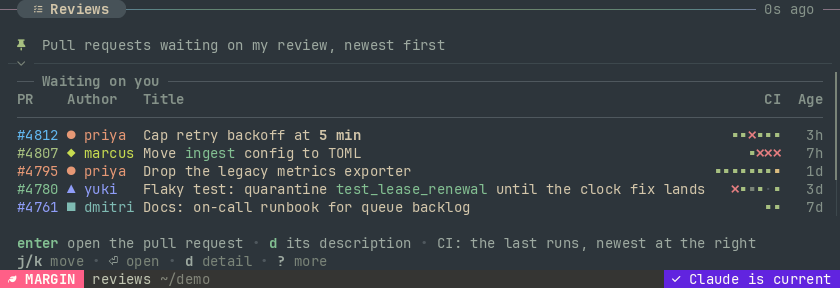

# margin

margin is a live terminal pane and the CLI that feeds it. A *board* is a document of typed
components (plan steps, questions, tables, run strips, plots); anything with a shell writes one,
and `margin view` draws it and redraws as it changes. What you do in the pane (tick a step, pick
an answer, press a key on a row) is appended to an event log, and handlers you register are run
for the events they asked for. No AI is involved in any of that. One consumer of it is
[Claude Code](https://claude.com/claude-code): a session keeps its plan in the pane and your
clicks go back to it (see [With Claude Code](#with-claude-code)). `vellum`, the second crate in
this workspace, is the terminal UI toolkit margin draws with.



The pane is not a rendered markdown file. Each row is a typed component with a stable id; whoever
writes the board owns its content, you own the decisions, and every decision is one event that a
handler, a script following the log, or a session's hooks can act on.

## What it does

- **Boards.** `margin new` creates one, `margin add/set/rm/move` and `margin apply` change it,
  and every write is checked against a schema (`margin schema`). Plan steps, questions with
  options, claims you can strike, sections, text, tables, run strips, name badges, plots.
- **A pane that only reads.** `margin view` watches the store and redraws; tabs show several
  boards (`margin view plan reviews`, `margin tab`); a detail panel shows the focused row in
  full. It runs nothing and opens nothing by itself.
- **Events.** Each decision and each action's key is a line in the project's log. `margin events`
  reads it, from a seq or a named cursor, once or following; `margin emit` appends a named event
  from cron, CI or a script.
- **Handlers, owners and datasets** keep a board current. A *handler* is a command margin's
  daemon runs when an event is appended (`margin handler add`): a refresh that cron emits, or a
  key you press on a row. An *owner* is a program margin does not run, registered as the writer
  of its rows (`margin owner add`, then `margin apply <board> --as <owner>`). A *dataset* holds
  numbers that change often (`margin data add`, `margin data append`): a plot or a table bound
  to it by name reads it when the pane draws, so a live plot needs no write to the board.
  Whoever keeps rows current owns them; nobody else can overwrite them. `margin help integrate`
  has the cron and systemd recipes.
- **Dashboards.** A pull-request queue, service health, a work tracker: `margin example` prints
  three complete ones (board, fetch script, sample data); see [docs/dashboards.md](docs/dashboards.md).
- **Shipped scripts** (`providers/`): a jj change ledger, a monitor of Claude Code sessions, a board
  of queued messages, a turn ledger. Each one's header gives the handler (or owner) registration
  and the cron line that run it.
- Also: long-form notes (`margin doc`), and toasts.



*Both pictures are real frames from `margin render`, drawn by the test harness
(`tests/e2e/shot.py`); two badge glyphs were swapped for ones its font has.*

## Install

[docs/install.md](docs/install.md) has the full steps. In short:

```sh
git clone https://github.com/SteveUlin/margin && cd margin
cargo build --release                           # or: nix build
```

That is all the core needs: the binary is `target/release/margin`.

## Quick start

By hand, in any directory:

```sh
margin new plan --title "Fix the flake"     # create: the only command that makes a board
margin add plan - section steps title=Steps
margin add plan steps todo t1 "Reproduce the flaky test"
margin ask plan Q1 "Seed from the test name?" yes no --suggest yes
margin open plan        # in Zellij: a split beside the tab you ran it from; elsewhere it prints the `margin view` command to run
margin set plan t1 status done
margin events           # what you did in the pane
```

Creating and changing are different commands: `margin new` creates a board and refuses one
that exists; every other write refuses a name with no board (and suggests the nearest), so a
typo is an error, never a second board. `margin example services | margin new services` makes a
sample dashboard, `margin demo` writes a larger sample plan (it needs difftastic), and
`margin help` lists every command and reference topic.
[docs/guide.md](docs/guide.md) walks through a board and a handler, then a session with Claude;
`margin help dashboards` and `margin help handlers` cover standing boards.

## With Claude Code

Everything for Claude Code is one command group, `margin claude`, and one command sets a machine
up:

```sh
target/release/margin claude init --user-name "<you>"  # your name, the skill, the hooks
```

`init` writes your name to margin's config, installs the skill to `~/.claude/skills/margin/`
and merges the hooks into `~/.claude/settings.json` (it keeps a `.bak` and leaves other hooks
alone; `--dry-run` prints the changes first). Restart Claude Code afterwards, then say "start a
margin for this" in a session.

- **The skill** teaches a session to keep a board: its plan as steps it ticks, questions with its
  suggestion marked and nothing chosen until you choose, assumptions you strike with a click.
  The session keeps working on whatever does not depend on your answer. `margin claude skill`
  prints it.
- **The hooks** (`margin claude hook <event>`) hand your decisions back as one line of context
  each: at the session's next prompt, after its next tool call, or by waking it when it is idle.
  They also tell the pane what the session is doing, and refuse its tool calls while you have
  pressed stop.
- **The pane** names Claude only on a board a session keeps (`margin claude link`): a live strip
  of what it is doing, its subagents, "Claude is current". A board no session keeps shows none
  of it.

`margin claude --help` lists the group.

## Requirements

- **Linux.** margin uses inotify, `/proc` and `flock`; other systems are untested.
- **Rust** (stable) to build, or nix (`flake.nix` pins the toolchain and the tools below).
- **Claude Code** is optional: only `margin claude …` (the hooks and the skill) needs it.
- **Zellij 0.45 or newer is optional.** Inside Zellij, `margin open` places the pane beside the
  tab it is run from without moving focus, and `margin session` makes a double-click on a token act. Without
  Zellij, run `margin view <board>` in any terminal; keys and mouse clicks work there.
- **A Nerd Font is recommended** for the state glyphs.
- Optional tools: `difft` (difftastic) for the demo; `bash`, `jq` and `jj` for
  the shipped scripts.

## Documentation

| file | what it covers |
|---|---|
| [docs/install.md](docs/install.md) | build, a first pane, `margin claude init`, undoing it |
| [docs/guide.md](docs/guide.md) | the model, walkthroughs of a board and a handler, a cheat sheet of commands, keys and config, then Claude Code |
| [docs/dashboards.md](docs/dashboards.md) | tables, run strips, badges, rules, and the theme |
| [docs/design.md](docs/design.md) | the original design, in its dated terms: owners, events, the toolkit, panes, and a feed runner that has since been removed (handlers, owners and datasets replaced it) |
| [docs/research.md](docs/research.md), [docs/landscape.md](docs/landscape.md), [docs/research/](docs/research/) | the measurements and prior art behind the design |

The design and research documents are dated notes from the build; they say "artifact" for what
the tool now calls a board, and describe a feed runner (`margin feed`, a command on margin's own
timer) that has been removed: a handler run by an event that cron emits, an outside owner or a
dataset keeps a board current now. Where they disagree with
`margin help` or the guide, the tool is right.

## Status

A personal project, early (0.1), built for one person's daily use. Commands, the document schema
and the store's file layout change without notice, and nothing is published to crates.io. Issues
are welcome; expect slow replies.

## License

MIT. See [LICENSE](LICENSE).
