# margin: design proposal

*2026-11-05. Approved and built as v0 the same day; §9b lists what changed in the build. Mechanism and evidence are in [research.md](research.md); product prior art in [landscape.md](landscape.md). This file makes the calls.*

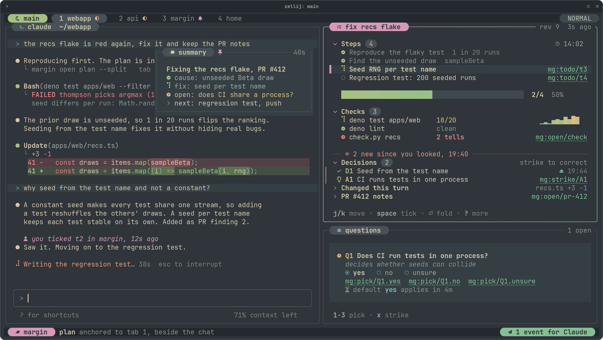

## What makes this more than a markdown file in a pane

The obvious first version of this idea re-renders a markdown file whenever it changes. Every terminal companion for Claude Code found in landscape.md works the same way: one owner, the AI; one direction, from the AI to the screen; nothing comes back. margin differs in four ways, and each is a mechanism, not a styling choice.

1. **Typed, stateful components with stable ids, not text.** A todo is a `todo` with a status, a finding carries a verdict, a question has options and an answer slot. Every one has an id that survives the AI rewriting the artifact. That makes them addressable (`mg:todo/plan.t3`) and lets updates land in place.
2. **Owners, enforced.** The AI owns *content*. sulin owns *decisions* (ticks, verdicts, picks, strikes, pins). Each pane owns *view state* (folds, scroll, focus, what he has seen). Since 2026-11-06 a **feed** (a registered script, §7b) owns the ids under its prefix; the feed runner has since become the legacy path, and a handler or a registered outside owner holds a prefix under the same rule. The AI cannot overwrite a decision sulin made or a feed's components, and an AI update never resets his scroll or folds.
3. **A return channel.** Every interaction becomes a typed event in an append-only log. The AI sees unread events at the start of its next turn (prompt hook), can block waiting for one (`margin events --follow`), and later gets them mid-turn (MCP channel).
4. **Live behaviour in the renderer.** Timers tick, spinners spin, progress eases to its new value, a changed block carries a change bar that fades once seen, a diff steps hunk by hunk, a graph steps through its stages. None of it costs a model round-trip.

---

## 1. Decisions at a glance

| question | call | why, in one line |
|---|---|---|
| language | **Rust**, one Cargo workspace | Zellij is Rust, so a later plugin shares types and the wasm32-wasip1 target (already in the flake); one static binary; Unicode correctness from mature crates; no GC pauses in a renderer that animates |
| UI layer | **our own toolkit, `vellum`** (terminal I/O → cell grid → layout → components → animation → images) | sulin will iterate on it for years; owning it means no framework ceiling and no fighting someone's immediate-mode model |
| engines | **use**: difftastic (structural diff), graphviz (graph layout), the `png` crate (decode), `unicode-width` and `unicode-segmentation`, `libc`, `serde_json`; tree-sitter later for highlighting | each is a hard, non-UI problem where a mature tool beats a rewrite |
| artifact model | a **typed component tree** in JSON, keyed by id, plus a separate human-state file and view-state file | lets the reconciler keep view state across AI updates and enforce ownership |
| AI interface | **CLI first** (`margin …` via the Bash tool), MCP server second with the same operations, plus a skill | the CLI works today with zero config; MCP adds typed tools and push (channels) |
| return path | event log + prompt hook; `margin events --follow` for blocking questions | sulin's ticks reach the AI on its next turn without him typing |
| pane control | **`zellij action` from outside, no plugin in v0** | 0.45's `--tab-id --no-focus` and `list-panes -j` meet every hard requirement (§6) |
| pane shapes | **pinned float** (glanceable) or **tiled split** (working surface) | the only two focus-safe shapes measured; plain floats steal focus on tab return |
| actions from the screen | **selection tokens** (`mg:…`) through Zellij's `copy_command`; keys when the pane has focus; mouse optional | selection works locally and over ssh; OSC 8 clicks don't over ssh |
| images | **kitty graphics at the cursor** (Zellij 0.45 re-emits it); halfblocks only as a marked last resort; no sixel | measured: placeholders and shm are refused by Zellij, Ghostty has no sixel |
| storage | `~/.local/state/margin/<project>/`, one dir per artifact | survives sessions, stays out of the repo |
| name | keep **margin**; the toolkit is **vellum** | "notes in the margin beside the chat" is the product exactly; vellum is the surface the notes are written on |

### We own / we use

**We own** everything that renders or interacts: raw mode and terminal capabilities; input parsing (keys including the kitty keyboard protocol, SGR mouse, focus, paste, and the kitty graphics replies Zellij writes back into the pane); the damage-tracked double-buffered cell grid; grapheme and width handling; colour; OSC 8; image placement (kitty) and the halfblock fallback; layout; every component; focus and navigation; animation; the selection-token grammar and dispatcher; pane management.

**We use** tools for engines that aren't UI: **difftastic** computes structural diffs and we draw its JSON; **graphviz** (and later mermaid-cli) lays out graphs into PNGs that we place; **`png`** decodes pixels for the fallback; **`unicode-width`** and **`unicode-segmentation`** answer width and grapheme questions, which are tables, not design; **`serde_json`** parses; **tree-sitter** comes later for syntax colours inside diff and code components. **Why the line sits here:** sulin wants to iterate on how things look and behave, and none of those engines decide either.

---

## 2. The interaction model

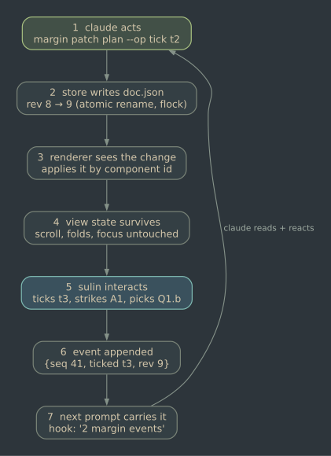

### Three owners

| layer | file | written by | examples | survives AI rewrite? |
|---|---|---|---|---|
| **content** | `doc.json` | the AI, via `margin` ops | titles, items, findings, diff sources, options, text | n/a (it *is* the rewrite) |
| **decisions** | `state.json` | sulin's interactions, via the renderer or `margin select` | `t3: done`, `h1: approved`, `Q1: b`, `A2: struck`, `pins` | yes, keyed by component id |
| **view** | `view.json` per pane | the renderer only | folds, scroll offset, focused id, seen-revisions per component, step index | yes, keyed by component id |
| **feed** | `doc.json`, ids under the feed's prefix | a feed's stdout, via the daemon | the jj ledger, agent rows, a feed's health line | n/a: the AI can't write there (§7b) |

**Conflict rules.**
- The AI can't write `state.json`. To change something sulin owns, for instance re-opening a todo he ticked, the AI sends `margin propose` (**not built yet**), which shows as a proposal on the component; his tick or dismissal resolves it. Why: a proposal is not consent.
- Some fields need both writers. **Todo status** is the main one: the AI marks `doing` and `done` as it works, and sulin ticks things too. Rule: status lives in `state.json` with a `by` and an `at`; the latest write wins, and when the AI's write overrules sulin's within one turn, the component flashes and logs `overruled` so neither change is silent.
- A content op carries `--base-rev N`. If `doc.json` moved on since N, the op fails with a clear error instead of silently applying to the wrong thing (landscape §6: claude.ai's update "succeeds" on a miss).
- When the AI removes a component that has decisions, the decision is kept and shown under "orphaned" until the AI acknowledges it. Why: a verdict sulin gave must not vanish because the AI restructured a list.

### Reconciling an AI update without losing his place

The renderer keeps the last tree. When `doc.json` changes (inotify), it diffs the new tree against the old one **by id**:
- A **kept** component keeps its fold, focus and scroll anchor. The scroll position is pinned to the first visible component's id plus an offset, not to a line number, so inserting content above him doesn't move what he's reading.
- A **changed** component gets a change bar (`▎` in the left gutter) that fades over about 2 s once the pane is visible. Its revision is marked unseen until the pane has been visible for a moment.
- An **inserted** component eases its height open over about 150 ms; a **removed** one collapses. With motion off (`MARGIN_MOTION=off`) both are instant.
- If the focused component disappears, focus moves to its nearest surviving sibling.

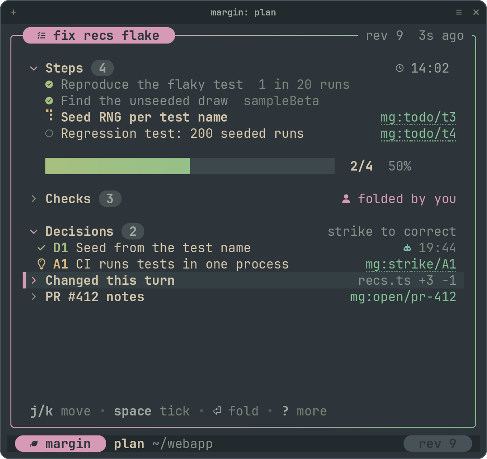

### Events: what flows back, and how the AI reads it

Every interaction appends one line to `<project>/events.jsonl`:

```json
{"seq":41,"at":"2026-11-05T19:58:02Z","artifact":"plan","id":"t3","kind":"tick","value":"done","by":"sulin","via":"select","rev":9}
```

Kinds: `tick`, `verdict` (approve/reject/ask on a hunk or finding), `pick` (answer a question), `strike` (an assumption or claim), `pin`/`unpin`, `fold`/`unfold`, `seen` (passive: a pane was visible for 1.5 s after a revision), `step`, `ask` (sulin selected `mg:ask/…`; the event carries his follow-up when he types one), `overruled`, `open`/`close` (pane lifecycle).

The AI reads events three ways, in build order:
1. **Next prompt (v0).** A UserPromptSubmit hook prints `margin events --unread --brief` (at most 8 lines, the rest summarised) and marks those events delivered for this session. That costs nothing when nothing happened. It runs beside any other UserPromptSubmit hook already registered.
2. **Blocking (v0).** `margin events --follow --name pick --artifact plan --json` blocks until sulin answers (`margin wait` did this until 2026-11; it was removed in favor of the event stream). Use it only when the AI truly can't proceed; the default is to post the question with a default answer and carry on ("never block").
3. **Mid-turn (later).** An MCP server registered as a channel pushes events into a running session; a PostToolUse hook is the fallback. This was unverified at design time, so it waits until checked.

Passive events (`fold`, `seen`) are logged but never pushed into the prompt. The AI asks for them (`margin events --kind seen`) when it wants to know whether he looked.

---

## 3. The artifact format

A **document** is a tree of typed components. The AI writes meaning (`finding`, `todo`, `question`), never layout. Markdown is an import/export format (`margin import notes.md`, `margin export plan --md`), not the model.

```json
{
  "id": "plan", "title": "fix recs flake", "rev": 9, "kind": "plan",
  "blocks": [
    {"type": "section", "id": "steps", "title": "Plan", "children": [
      {"type": "todo", "id": "t1", "text": "Reproduce the flaky test", "note": "1 in 20 runs"},
      {"type": "todo", "id": "t3", "text": "Seed RNG per test name"}
    ]},
    {"type": "progress", "id": "p", "of": "steps"},
    {"type": "timer", "id": "clock", "since": "2026-11-05T19:44:00Z"},
    {"type": "question", "id": "Q1", "text": "MCP in v0?", "options": ["cli", "mcp", "both"], "default": "cli"}
  ]
}
```

### Components

Two layers. **vellum's parts** draw things and know nothing about Claude: they take input and report it upward. **margin's artifact components** are what Claude writes into a document: each is built from vellum parts, has an id, splits its fields between three owners (Claude's content in `doc.json`, sulin's decisions in `state.json`, each pane's view in `view.json`), and turns interactions into events. Phases: **v0** is the first build (§9), **v1** follows once v0 holds, **v2** waits on something named in the row.

Colour carries one meaning per hue, always doubled by a glyph or word so it reads in greyscale: purple = you (your decisions, pins, focus), aqua = actionable (tokens, links), green = done or healthy, yellow = in progress, waiting or assumed, orange = changed since you looked, red = failed, must-fix or struck, blue = Claude's content and read-warrant, grey = meta. The base is Everforest dark; the look leans toward Charm's (rounded borders, pill labels, gradient focus, padding, a quiet help line).

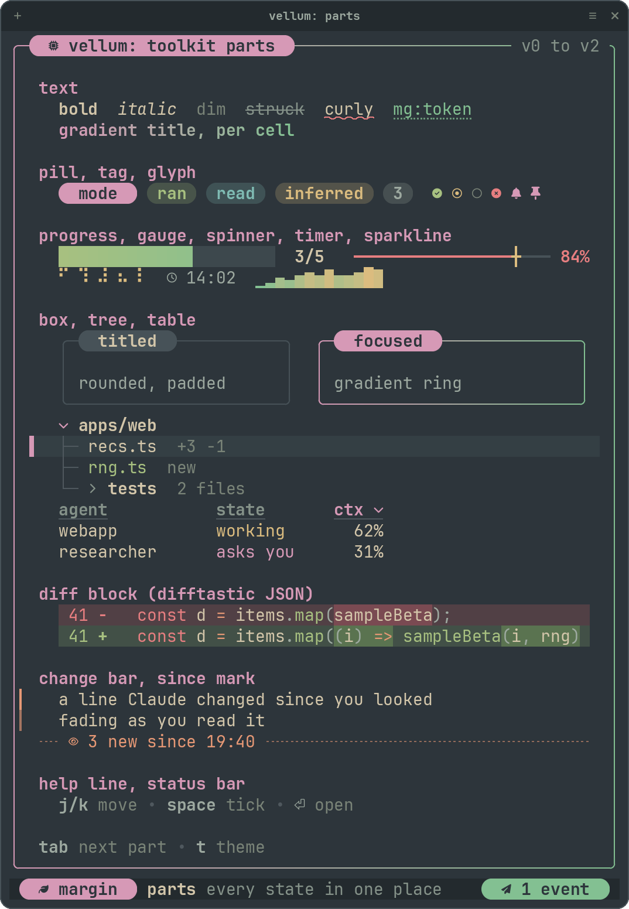

**vellum parts (the toolkit)**

| part | what it draws | states | input | phase |
|---|---|---|---|---|
| text | styled runs: bold, italic, dim, strike, underline (single, curly, dotted, coloured); per-cell gradient; NFC-normalised, wrapped by grapheme width | normal, dim (stale), struck | — | v0 |
| box / border | rounded (default), heavy or light frame; a pill title set into the top edge, meta right-aligned in it | plain, focused (purple→aqua gradient ring), pinned (pin glyph) | — | v0 |
| list | rows of glyph, text, aside, right-aligned token | normal, focused (raised ground, purple caret), changed (gutter bar) | `j/k` move, `space` act, `⏎` open | v0 |
| collapsible | chevron, bold title, count tag, right note | open, folded, folded by you (noted) | `⏎` or `h/l` | v0 |
| tree | a collapsible with `├─ └─ │` guides | open, folded, selected | `h/l` fold, `j/k` move | v1 |
| table | underlined header, column-width solver, aligned cells | sorted (purple header + chevron), selected row | `j/k`, `s` sort | v1 |
| status bar | app badge pill, artifact name, a state chip right | idle, event pending, Claude read it | — | v0 |
| help line | key and description pairs with `•` between; follows focus (Bubble Tea's help) | per focus | `?` expands | v0 |
| progress | gradient block bar with eighth-block edge; value moves on a critically damped spring | value, done | — | v0 |
| gauge | thin `━` line meter with a `╋` threshold notch; colour steps green → yellow → red | under, near, over threshold | — | v1 |
| spinner / timer | MiniDot braille at 10 fps; elapsed or countdown at 1 Hz | running, stopped, overdue | — | v0 |
| sparkline | eight-level blocks, height and colour both carry the value | — | — | v1 |
| badge / pill / glyph | solid pill, soft tinted tag, Nerd Font state glyphs | per meaning (colour table above) | — | v0 |
| image (kitty) | a PNG placed in a cell rectangle; content hash is its kitty id; halfblock fallback marked `image: blocks` | loaded, fallback, missing | `g` full size | v0 |
| diff block | difftastic JSON: tinted lines, changed tokens in a stronger tint, Everforest syntax colours; unified when narrow, side by side when wide | hunk focused, verdict set | `n/N` hunk (not built yet), `a/r/?` verdict | v0 (read-only verdicts) |
| graph | graphviz → PNG via the image part, one node lit per step | step n of N | `←/→` step | v2 (after images prove out) |
| token / link | `mg:` text with a dotted aqua underline; URLs open through `opener` | idle, selected, flash (150 ms inverse), sent | double-click (Zellij `copy_command`) | v0 |
| change bar / since mark | `▎` in the gutter fading through three tones; an orange `n new` badge beside the title pill once a change has gone unseen for 3 s (no row of its own, so nothing jumps; latched, so a feed writing while you watch never blinks it) | fresh, fading, gone | — (looking at it fades it) | v0 |

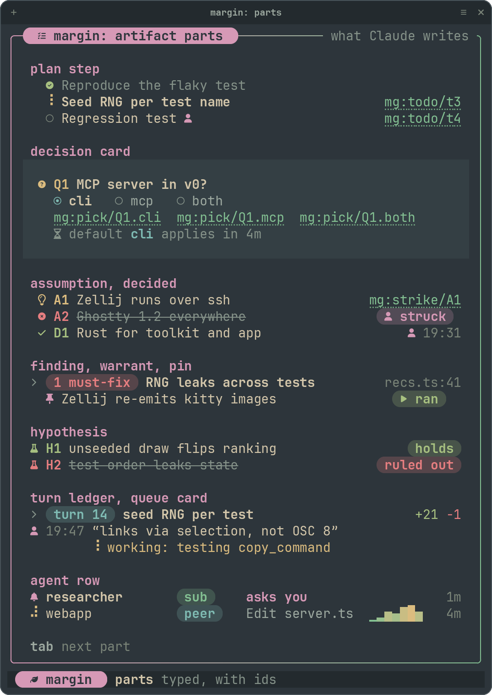

**margin artifact components**

| component | what it shows | states | you do (key / token) | event to Claude | Claude writes / you decide / view keeps | phase |
|---|---|---|---|---|---|---|
| `section` | collapsible group with count and note | open, folded | `⏎` | `fold` (passive) | title, children / — / fold | v0 |
| `text` | a paragraph; first sentence when folded | normal, stale (dim) | — | — | text / — / — | v0 |
| plan step (`todo`) | state glyph, text, aside, `mg:todo/<id>` | todo, doing (spinner), done, blocked | `space` / `mg:todo/t3` | `tick` | text, status / tick (shared: latest wins, an overrule flashes and logs) / focus | v0 |
| `progress` | derived from a section's steps, or a value | value | — | — | value or source / — / — | v0 |
| `timer` | elapsed or countdown | running, overdue | — | — | start, deadline / — / — | v0 |
| check (`status`) | spinner, command, count, sparkline | running, pass, fail | `⏎` opens the log | — | command, state (or a hook writes it) / — / — | v0 |
| decision card (`question`) | question, why, options as radios, the default and when it applies | open, picked by you, default applied, sent | `1-3` / `mg:pick/Q1.mcp` | `pick` (pushed) | question, options, default / answer / focus | v0 |
| defaults board | the open decision cards, assumptions and decided rows of one artifact | — | — | — | composition / — / folds | v0 (plan + inbox) |
| decided row | id, decision, who decided, when | — | `⏎` why | — | text, who / — / — | v0 |
| `link` | a token or URL | idle, sent | double-click / `mg:open/pr-412` | `open` | target / — / — | v0 |
| `image` | a picture in a cell slot | loaded, fallback | `g` | — | path / — / — | v0 |
| `diff` | a hunk with verdict tokens | unreviewed, approved, rejected, asked | `a/r/?` / `mg:approve/412.h1` | `verdict` (pushed) | hunk / verdict / hunk focus | v0 (read-only verdicts) |
| `row` | one ledger or monitor line: state glyph, tag pill, text, grey aside, live age (`since`) or `meta`, optional detail line | per glyph: spin, done, fail, you, perm, idle, ended, commit, wc, file | — | — | all fields (a feed, usually) / — / — | built 2026-11-06 |
| `feed` | a feed's health line: live, crashed with restart countdown and error, paused, removed; "wrote 3s" | live, restarting, failed, paused, removed | — | — | written by the daemon / — / — | built 2026-11-06 |
| assumption line (`claim`) | bulb, id, text, `mg:strike/<id>` | live, struck by you (with reason), acknowledged | `x` / `mg:strike/A1` | `strike` (pushed; Claude must answer) | text / strike + reason / — | v1 |
| warrant badge | `ran`, `read` or `inferred` tag on a claim; `ran` needs captured output | — | `e` evidence | — | warrant + evidence / — / — | v1 |
| pin | pin glyph on any claim or finding | pinned, unpinned | `p` (not built yet) | `pin` | — / pin / — | v1 |
| finding card | severity tag, title, where, body, diff, verdict tokens | open, folded, approved, rejected | `a/r/?` | `verdict` | finding / verdict / fold | v1 |
| turn-ledger entry | turn tag, summary, +/− per file, the diff | folded, open, revert asked | `⏎`, `d` diff, `R` / `mg:revert/14` | `revert` (a proposal) | derived from jj / revert request / fold | v1 |
| agent row | state glyph, name, kind tag, status, activity sparkline, age; opens to the question and its tokens | working, waiting on you, running, done, failed, idle | `⏎`, `a` attach / `mg:yes/scout` | `pick` → a proposal to the owning session | derived from transcripts and hooks / answer / expanded | v1 |
| context gauge | context use per session with the compaction notch | under, near, over | — | — | derived / — / — | v1 |
| queue card | your message, its time, Claude's outcome | queued, working, done, changed the plan, dropped | `⏎` jump, `d` drop | `drop` | outcome / drop, merge / focus | v2 (needs queued messages to be observable) |
| hypothesis | flask, id, text, state tag, evidence line | untested, testing, holds, ruled out | `x` strike, `p` pin | `strike` | text, state / strike / — | v2 |
| stepper + check question | step pills over a graph; one question with a right answer | step n; unanswered, right, wrong | `←/→`, `1-3` | `pick` | steps, question / answer / step | v2 |
| summary float | four lines: what, cause, open, next | shown, dismissed | `x` | `dismiss` (passive) | text / dismissed / — | v2 |

### AI operations

The AI never re-sends a whole large document. Since 2026-11-06 (the API review, `docs/api-review.md`) there is **one write, `margin apply`**, whose stdin is the feed line grammar (`feed.rs` `parse_input`): an op, an op array, a whole component (upsert by id: replace in place, else add to its `parent` or the top level), a whole-document envelope `{"v":1,"title","blocks"}`, or several lines of these, all applied all-or-nothing. `set` takes `fields` for several fields at once (`null` deletes one). (`put` and `patch` were aliases at first; they are gone: `margin new` creates an artifact and `apply` only updates one.) Why one grammar: Claude, feeds and any future client then share one parser, upsert ends the "does it exist yet?" round-trip, and JSON on stdin ends shell-quoting and type guessing. The id-addressed sugar stays for one-liners:

```fish
margin apply plan < plan.json                                      # whole doc, a component, or ops
margin apply plan --base-rev 9 --json < ops.json                   # all or none; prints {"v":1,"artifact","rev"}
margin add plan steps todo t4 Regression test: 200 seeded runs     # insert into a parent; every bare word is text
margin set plan t3 status=doing note="1 in 20 runs"                # fields, typed by the schema
margin rm plan t2
margin move plan t4 --before t3
margin schema [todo] [--json]                                      # the component schema
margin diff pr-412 add apps/web/recs.ts --rev @- --to @           # diff block from jj revisions
margin image explain add graph.png --alt "matcher pipeline"
margin ask plan Q1 "MCP in v0?" cli mcp both --default cli
margin propose plan Q1 pick mcp --why "the bug agent calls it"   # offer a change to one of his decisions
margin show plan [--json]          # content + decisions merged, what sulin sees
margin events [--unread] [--artifact plan] [--since 40]
margin open plan [--float|--split] [--tab-id N]
margin close plan
margin ls
```

**Proposals** (added 2026-11-06). `margin propose <art> <id> <verb> [value]` lets Claude offer a change to a field sulin owns (tick, pick, strike, approve, reject) without making it. The proposal is Claude's content: a `proposal` field `{verb, value, why, at}` on the target, validated against it (a pick must name an option, a tick a todo). The pane shows it under the component in purple, his colour, because the call is still his: `proposes  pick mcp  <why>` and accept / decline (buttons with the mouse on, `mg:accept/<id>` `mg:decline/<id>` tokens otherwise). Accept applies the decision through the same path as his own pick or tick (`select::apply_in`), so it lands as his, then records the answer; decline records only the answer. The answer is a `proposal` event (Claude gets "sulin accepted/declined your proposal to …") plus a resolution under `<id>#proposal` in `state.json` holding the proposal's `at`: that proposal stops showing, and a newer one on the same component (another `at`) shows again. Why not let Claude set the field and let him undo it: a decision that changes under him is worse than none (§2, three owners); a proposal costs him one click and never moves his state on its own.


**The component schema** (added 2026-11-06). `doc.rs` `SCHEMA` lists each type's fields with a type (text, number, bool, list, numbers, enum, json), whether it holds children and sulin's action on it. Every write path checks against it: `Doc::apply` checks the block an `add` or `replace` carries and the field a `set` writes, and `put` checks the whole document; feeds go through the same `apply`, so a bad feed line is rejected and logged while its other lines land. Errors name the fix: `unknown field "txt" on todo (did you mean text?)`, `todo status "bloked": one of todo doing done blocked skipped next (did you mean blocked?)`. CLI values are typed by the schema (`doc::coerce`): a text field keeps `2026` as the string "2026". `margin schema` prints the table, so the skill and the guide point at it instead of keeping their own copies. Only the blocks a write touches are checked, so a document stored before the schema keeps working. One todo status vocabulary (`doc::STATUSES`) serves both Claude's `set` and sulin's tick.

**Stable ids** (2026-11-06). A todo, question, claim or diff written without an id gets a slug of its text (`doc::slug`, `-2` on a clash), never a positional `t2`: decisions are keyed by id, and a positional id carried sulin's tick onto whatever landed in that position on the next `put`. One without text must carry an id.

**Versions.** `doc.json`, each event and an `apply` envelope or line carry `"v": 1`; a missing `v` reads as 1 and any other value is refused.
Every write takes the project's lock (`flock` on `<project>/.lock`), writes `doc.json.tmp`, renames it into place, and bumps `rev`. (Old revisions were appended to `history.jsonl` until 2026-11; nothing read it, so it is no longer written.) Every write prints the new `rev` and any error. Why rename-into-place: the renderer must never read a half-written file.

### Storage

```
~/.local/state/margin/<project>/          # project = git/jj root slug, else cwd slug
  events.jsonl                             # append-only, all artifacts
  .lock
  plan/
    doc.json  state.json
    view/<pane-id>.json                    # per pane: folds, scroll anchor, focus, seen
  pr-412/ …
```

Artifacts belong to the **project**, not the session, so the next Claude session in the same project sees yesterday's plan with `margin ls`. Each artifact records the session ids that wrote it. jj-versioning the whole directory is a cheap upgrade later.

---

## 4. The toolkit: vellum

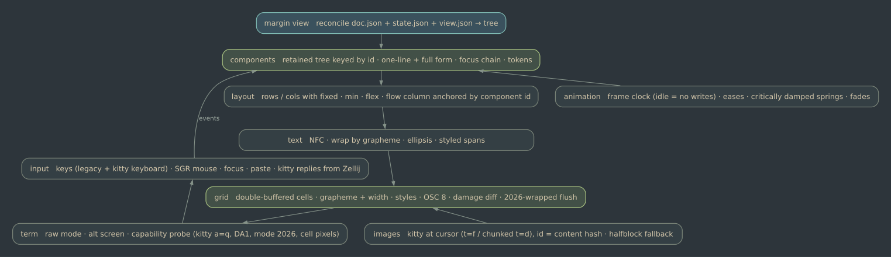

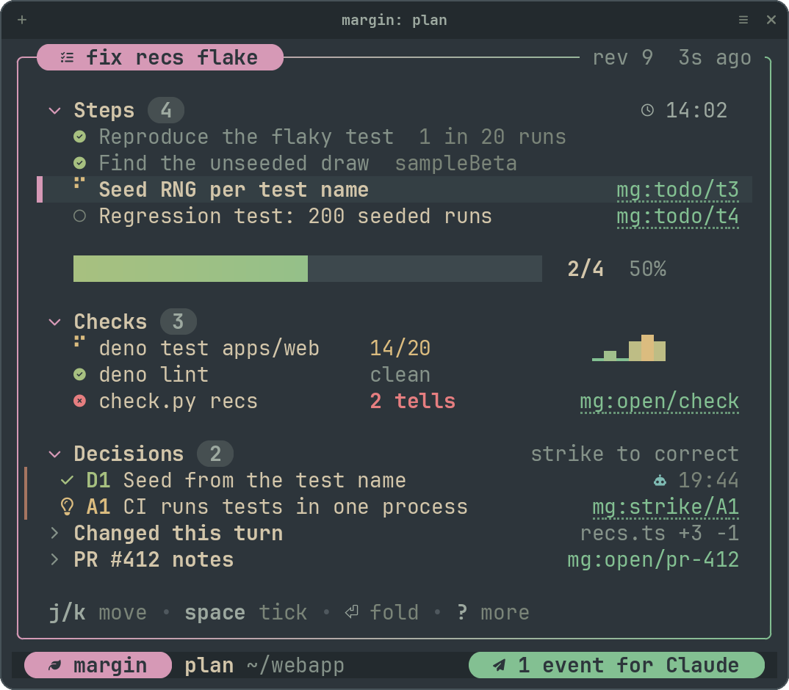

Design points, each with its reason:
- **A retained tree, not immediate mode.** margin's documents are retained already, and reconciliation by id is what preserves view state. The renderer walks the tree to produce a frame; the frame goes through the grid diff, so only changed cells get written. Why: it gives Ratatui's flicker-freedom without its "rebuild everything every frame" model.
- **The grid is the only path to the terminal.** Components never print escape codes. The grid compares frames, emits minimal SGR transitions, cursor moves and OSC 8 open/close, and wraps each flush in `CSI ? 2026 h/l`. Wide graphemes take two cells with a continuation marker. Why: every correctness bug in terminal UIs (width, colour bleed, link bleed) gets fixed once, in one place.
- **Idle means silent.** The frame clock runs only while something animates (a spinner, an easing, a fading change bar). Otherwise the renderer sleeps in `poll()` on stdin plus an inotify fd. Why: the pane often sits on a machine that runs other jobs, and a pane nobody looks at should cost nothing.
- **Springs for values, eases for reveals.** *Revised after sulin's review (2026-11-05): he asked for bouncy springs and a calm pulse.* Progress and resolving cards move on springs that overshoot and settle (`SpringCfg::BOUNCY`, ζ≈0.52). Folds and inserts ease their height (ease-out in, ease-in out). Change bars fade continuously once seen. A card that needs him breathes three times (a raised cosine, 2.4 s) and then rests. The focused panel's border is a gradient that flows around it. Every one of these is off with `motion: "off"`, and none runs unless something is live.
- **Images are a layer, not cells.** An image component reserves `c×r` cells, and the grid emits the kitty placement after the cell flush with the cursor parked at the slot. The image's content hash is its kitty id, so an unchanged image isn't re-sent; Zellij keeps it with the pane. The fallback renders halfblocks into the same slot with a dim `image: blocks` tag.
- **Input knows about Zellij.** Zellij writes kitty graphics replies (`ESC_G…OK` or `ENOTSUPPORTED`) into the pane's input [ran], so the parser consumes them rather than treating them as keys.
- **Mouse reporting off by default.** Selection is the universal input, and mouse reporting would stop double-click selection inside the pane. A key (`m`) toggles mouse mode for local sessions.
- **Testable headless.** `margin render plan --width 70 --height 30 [--ansi]` renders a frame to stdout without a terminal. Unit tests snapshot frames as text. The e2e test runs a Zellij session with a fake client, as in research.md.

**Why Rust over Go or TS/Deno.** Deno is sulin's default for his other projects, but a TUI toolkit lives on raw-mode syscalls, a hot diff loop and precise Unicode width, where Rust is strongest. Rust also matches Zellij, so a future plugin reuses margin's types and compiles from the same flake. Go would be a reasonable second choice, but it shares nothing with Zellij, and Go's terminal ecosystem pushes toward Bubble Tea's string-based layout, which is exactly what we're replacing.

---

## 5. Actions from the screen: selection tokens

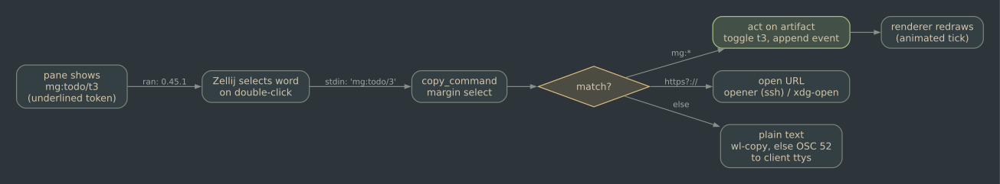

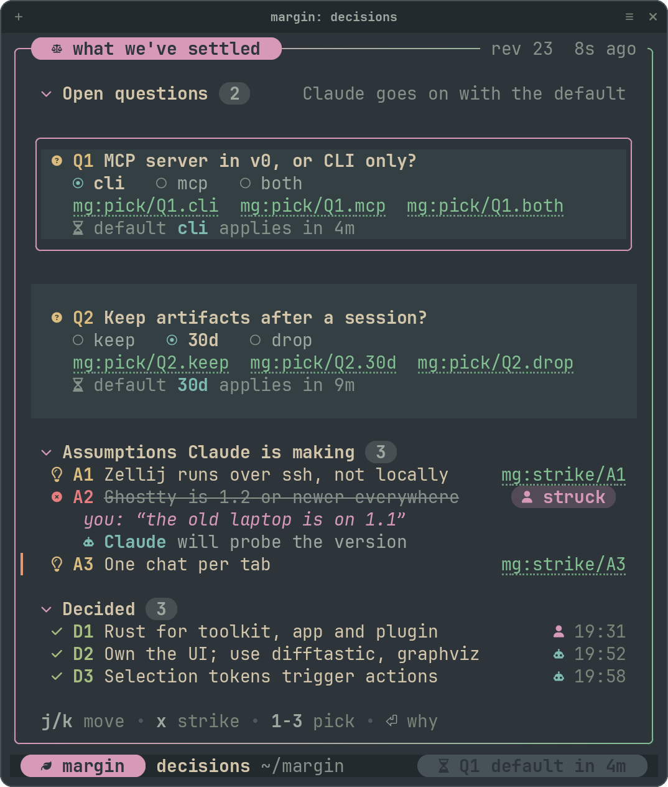

**Grammar.** `mg:<verb>/<artifact>.<id>[=<value>]`, for example `mg:todo/plan.t3`, `mg:pick/plan.Q1=b`, `mg:approve/pr-412.h1`, `mg:open/pr-412`, `mg:strike/decisions.A2`. Tokens are drawn underlined in aqua and always stand between spaces. Zellij's double-click selects a whole whitespace-delimited word including `:/.=,_-~` [ran: all four test tokens came through whole], so a token never needs a drag. The artifact part can be omitted inside a pane that shows only one artifact; the renderer prints the short form and the dispatcher resolves it [inferred].

**Dispatcher.** sulin's Zellij config gets `copy_command "margin select"`. The dispatcher:
1. A line matching the token grammar gets applied: update `state.json`, append the event, done. The renderer watching `state.json` redraws, with a short tick animation.
2. A line starting with `http(s)://` gets opened through the configured opener: `opener` or its `xdg-open` shim when `SSH_CONNECTION` is set, else `xdg-open`.
3. Anything else goes to the clipboard: `wl-copy` when a Wayland display is reachable, else OSC 52 written to each client tty of `$ZELLIJ_SESSION_NAME` (client ttys found through the session socket's peers) [mapping ran; OSC 52 write not yet tested].

**Why this beats a plugin for v0.** A plugin can receive pipes, but I found no documented "selection happened" event. `copy_command` is already the hook for selections, and it's one line of config. Some setups route highlighted text into a Zellij plugin. If such a plugin gets selections through an API I missed, margin's dispatcher can sit behind it unchanged.

**Keys, when the pane has focus.** Vim-style through `vellum::keymap` (counts, `gg`, `zc`/`zo`/`za`, `]]`, `/` with `n/N`; the full table is in the guide). `j/k` move, `space` cycles a todo or acts, `⏎` folds or opens, `a/r` approve or reject, `n/N` next or previous hunk (not built yet), `←/→` steps, `p` pins (not built yet), `x` strikes, `?` shows help. The footer lists only the keys that do something on the focused component, as k9s and gitui do.

---

## 6. Panes: anchored to the chat's tab, never stealing focus

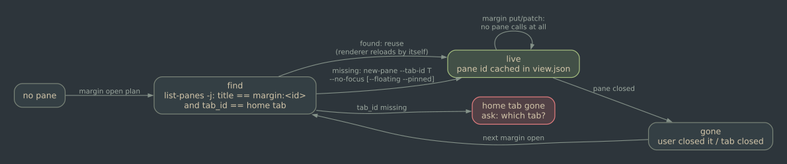

**Home tab.** `margin open` resolves the tab from `$ZELLIJ_PANE_ID` (the pane Claude Code runs in) via `list-panes -j`. It stores the stable `tab_id`, never the position or the name, which change when sulin moves or renames tabs. `--tab-id` overrides it.

**Find or create.** Each margin pane is named `margin:<artifact>`. `open` lists panes; if one with that title exists in the home tab, it's reused (the renderer already watches the files, so there is nothing to send). Otherwise:
- `--float` (default for glanceable artifacts like a summary or plan): `new-pane --tab-id T --no-focus --floating --pinned true -x 62% -y 2 --width 37% --height 45% -n margin:plan -- margin view plan`
- `--split` (for working surfaces like a review or explainer): `new-pane --tab-id T --no-focus -n margin:pr-412 -- margin view pr-412`, which lands in the biggest free space.

`margin apply/set/add` never touch Zellij at all. Updates reach the pane through the files, so the AI can update an artifact a hundred times with zero pane churn.

### CLI-only versus a plugin

| capability | `zellij action` (0.45.1) | a plugin adds |
|---|---|---|
| open a pane in a specific, non-focused tab without moving focus | **yes**: `--tab-id --no-focus` [ran] | same |
| choose the split side in that tab | **no**: `--tab-id` + `--direction` silently fails [ran] | yes, via open-near plus `break_panes_to_tab_with_id`, or `new_tiled_pane_in_tab` [read; inferred for commands] |
| detect an existing pane for an artifact | **yes**: `list-panes -j` by title and `tab_id` [ran] | yes, pushed via `PaneUpdate` instead of polled |
| react to tab or pane events (tab closed, pane closed, focus) | poll `list-panes -j` (cheap, about 1 call per second while a margin pane is open); the CLI has no event stream (`zellij subscribe` streams a pane's *rendered output*, not events) [ran `--help`] | **yes**: `TabUpdate`, `PaneUpdate`, `PaneClosed` events |
| route link clicks or selections | **yes** via `copy_command` [ran] | pipes in; no documented selection event found |
| tab badges ("2 events") | **yes**: `rename-tab-by-id` | same, plus reacting to focus to clear them |
| know which pane sulin is looking at (for `seen`) | poll `list-panes` for `is_focused` and the active tab | event-driven |
| cost | none | a wasm build, plugin install and permission grant, coupling to Zellij's plugin API version (it changed in 0.44 and 0.45), and plugin crashes show up in his session |

**Verdict.** No hard requirement needs a plugin, so v0 ships without one. The smallest useful plugin later is about 200 lines (`margin-zj`): subscribe to `PaneUpdate` and `TabUpdate`, keep the manifest in memory, answer `zellij pipe --name margin` queries, and open panes on a chosen side. It earns its keep when sulin wants precise split placement or the `seen` signal without polling.

---

## 6b. Hosts: Zellij, or no multiplexer at all

*Added 2026-11-06.* Pane placement sits behind a small `Host` trait in margin (`host.rs`): `open`, `find`, `close`, `is_visible` (for `seen`), `selection` (how a selected token reaches margin) and `session`. vellum knows nothing of hosts; `margin view` is a plain terminal program either way.

| | `ZellijHost` | `PlainHost` |
|---|---|---|
| `margin open` | split or pinned float in Claude's tab, no focus change (§6) | prints `margin view <art> --project P` to run in any terminal; reports `reused pid N` if one runs |
| find / close | panes titled `margin:<art>` / `close-pane` | `margin view <art>` processes of this project (/proc) / SIGTERM, which the renderer handles by restoring the terminal |
| `seen` | is the pane's tab the active one (polled 1 Hz only while a change is unseen) | assumed visible |
| selection | `copy_command` → `margin select`, plus keys and mouse in the pane | keys and mouse in the pane only, so mouse reporting starts on: a click on a token acts |
| session | `margin session` (session-only options) | none |

Config `host: "zellij" | "plain" | "auto"` (env `MARGIN_HOST`); auto picks Zellij when `$ZELLIJ_SESSION_NAME` is set or `--session` is given. **Why:** margin should work in a bare Ghostty tab or over ssh without Zellij, and a second host (tmux, a Zellij plugin) then means one new impl, not a hunt through `app.rs` and `select.rs`.

---

## 7. Agent monitoring

*As built (2026-11-06): the monitor is the `agents` feed (§7b, `feeds/agents`).* It reads transcripts and `/proc`, never message bodies: a row's last action is a tool name plus a short label (Bash's own `description`, a file's basename, an Agent's description, a URL's host), and queued messages are counted, not shown. One honest limit: a tool call pending for a minute is either still running or waiting on a permission prompt, and the transcript can't tell those apart, so the row says exactly that. The Notification-hook route below would make it exact.

The agent monitor is a `live` artifact. Its content comes from **sources**, not from the model, so it costs zero model actions (landscape §6: maintenance eats turns).
- **Claude Code sessions and subagents**: tail `~/.claude/projects/*/*.jsonl` and `*/subagents/*.jsonl` for the last tool use, state (working, waiting, idle by time since last line) and context use [read: layout from research].
- **Hooks**: a SubagentStart/SubagentStop/Notification hook appends to margin's event log, making "waiting on you" exact instead of guessed.
- **Other background jobs**: a job runner's status command and `systemctl --user list-units --failed`.
- **Peers**: the session registry Claude Code exposes through `ListAgents` [inferred: reachable from a session, not from a plain process; to check].

Actions on a row are tokens (`mg:stop/<agent>`, `mg:attach/<agent>`, `mg:yes/<agent>`). The ones that change something outside margin only **propose**: they write an event that the owning session picks up, never a direct kill. Why: a worker's suggestion isn't sulin's consent, and the same holds in reverse.

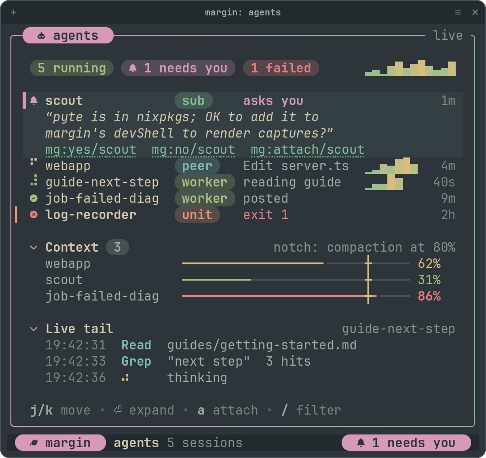

---

## 7b. Feeds: artifacts that stay current without the AI

*Added 2026-11-06; sulin approved the design as specified.* *Legacy now:* this runner (a script on margin's own timer, file watch or stream) still works, and is no longer the main path. A board is now kept current by a handler run for an event that something outside schedules, by an outside program registered as an owner of rows, or, for numbers that change often, by a dataset the pane reads (`margin help handlers`, `margin help integrate`, `margin help dashboards`); what follows is the record of the runner. A **feed** is a registered script that keeps part of an artifact current: the jj ledger, the agent monitor, a build's status. Without feeds every live number costs a model turn (landscape §6: maintenance eats turns), or goes stale.

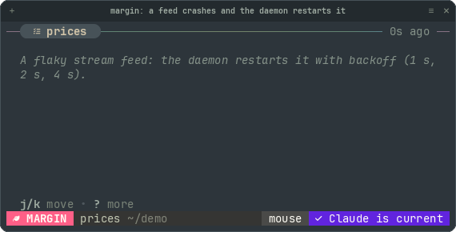

**Model.** A feed is a name, a command (argv, run without a shell in the directory it was added from) and a trigger:

| trigger | runs | lands as |
|---|---|---|
| `--every 10s` | the command every interval | one revision per run (all its lines, each line all-or-nothing) |
| `--watch <path>…` | once at start, then on each change (inotify, 250 ms debounce; a watched file is watched through its directory too, because jj and editors replace by rename) | same |
| `--stream` | one long-running process | each line as it arrives, coalesced to one write per `--min-gap` (default 1 s) |

Each stdout line speaks the AI's own language: one op (`{"op":"set",…}`), an array of ops (atomic), or a whole component (`{"type":"section","id":"jj",…}`), which becomes a new `replace` op: swap the component with that id in place, or append it. Reconcile-by-id keeps folds and focus across a feed's rewrites exactly as across Claude's. A replace of the same id supersedes a queued one, so a flood of 1000 lines between writes costs one apply.

**Ownership: the fourth owner.** A feed owns the ids `P` and `P-…` (or `P_…`) for its `--owns` prefix `P` (a prefix ending in `-` or `_` covers what starts with it; `ci` never covers `city`, 2026-11-06) (default: its name; `*` = the whole artifact) in its `--artifact`. The store enforces it on every op (`store.rs` `check_owner`, against the ids an op touches *including descendants and the parent it inserts into*):
- a feed's write outside its prefix, or into a parent it doesn't own, is rejected and logged; its other lines still land;
- Claude's write inside a feed's prefix is rejected with the feed's name and how to stop it; a whole-doc `put` must carry feed components through unchanged;
- sulin's decisions on a feed component are rejected: feed output is read-only;
- two feeds on one artifact can't claim overlapping prefixes.

Feed revisions carry `by: feed:<name>` in `doc.json`. A job's lifecycle (start, crash, restart, stop) is state, kept in its status file and its log (`margin job ls`, `margin job logs`), not in `events.jsonl`: the log holds facts someone may react to. (Logs written before 2026-11-10 still hold passive `feed` lines; they parse and are never delivered.)

**Lifecycle** (of the legacy runner; the same daemon now also dispatches events to handlers, which have no timer). `margin feed add` writes `feeds.json` (per project store, under the project lock) and starts `margin daemon` if none runs. The daemon (one per project, held by `flock` on `daemon.lock`) re-reads the registry every 300 ms: it starts a worker thread per unpaused feed, stops removed or paused ones, restarts changed ones, and exits when no unpaused feed is left (checked under the project lock, so an `add` racing the exit is never lost). Workers run commands in their own process group with `PR_SET_PDEATHSIG`, so a stop kills the whole pipeline and a hard-killed daemon takes its children with it. A crashed stream (any exit counts) or a failed run restarts after 1, 2, 4 … 60 s; a run that stayed up 30 s resets the backoff. stderr goes to `feeds/<name>.log` (512 KB, one rotation). Each feed keeps a **health line** (a `feed` component, `<prefix>-feed`) above its root: live, `crashed · restart in 4s` with the error under it, paused, or removed, plus a live "wrote 3s" age. `units/margin-daemon@.service` runs the daemon under systemd instead (not installed).

**Why hooks stay read-only.** The prompt and post-tool hooks run inside Claude's turn, once per tool call. They only read `events.jsonl` and write one cursor file; they never start, wait on, or talk to a feed or the daemon, and feeds never run inside a hook. So a wedged or busy feed can't slow a turn or block it on a lock (the hooks take no lock). Measured [ran, `tests/e2e/feeds.py`, debug build]: with a feed writing 20 revisions a second, `margin hook prompt` took median 2.2 ms, max 8.9 ms over 40 calls, each reading and describing every unread event as a new session would.

**The shipped feeds** (`feeds/`, bash + jq, read-only):
- `jj`: watch-triggered on `.jj/repo/op_heads/heads`; one row per recent change (change id, description, +/− and files, age) and the working copy's files. It reads with `--ignore-working-copy`, because a feed whose reads recorded jj operations would retrigger its own watch forever; unsnapshotted edits show at the next jj command anyone runs, and the section note says "as of last jj op".
- `agents`: a stream that polls every 2 s, re-parses only transcripts whose size or mtime changed (the last 256 KB of each), and prints only when the rows changed; ages tick in the renderer. Rows sort by urgency: possibly waiting on permission, your turn, working, idle, ended.
- `queue` (added 2026-11-06): a board of sulin's queued messages in one session, from the transcript's `queue-operation` and `queued_command` entries (research §7b). Each message moves waiting → absorbed (turn n, it rode into the running turn beside a tool result) → answered (that turn ended), or waiting → next turn (it waited for the turn's end and became turn n) → answered, or → dropped (`popAll` pulled it back into the input box, or a `remove` without delivery). A message typed between turns (enqueue then dequeue within 1.5 s) never waited and never shows. It prints only a message's first line, cut to 60 chars, and skips notifications and agent messages that share the queue (they start with `<`). A `remove` lands in the file before its `queued_command`, so a removed message reads as absorbed for 5 s before it can read as dropped.
- `turns` (added 2026-11-06): one folded section per turn of one session (latest open): `#n  14:02  @kxyz  <prompt's first line, 18 chars>` with `4m12s · 9 tools · 3 files` (the prompt last, so a narrow pane cuts it first); open, it lists the files the turn wrote and its tools by count. A turn starts at a prompt that isn't a tool result, meta line or compact summary (`feeds/lib/transcript.jq` `starts_turn`, shared with `queue` so both number turns alike) and ends at `end_turn`; one silent for 10 min without it reads "stopped after". The jj change is the working copy at the turn's end: the newest jj operation at or before it, read with `--at-op` and `--ignore-working-copy` (cached per operation), so the feed records no operation.
- Both transcript feeds follow the newest transcript of their directory's project unless given a session id or path (`feeds/lib/session.sh`), so a restarted Claude needs no re-registration; both read the whole file but only when its size or mtime changed (about 0.05 s and 0.25 s per render on a 5.5 MB session [ran, `time`]; while Claude works the file changes every poll, so `turns` costs up to ~12% of a core then, and nothing while the session is quiet [inferred from the 2 s poll]).

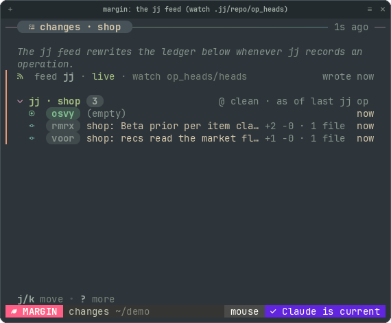
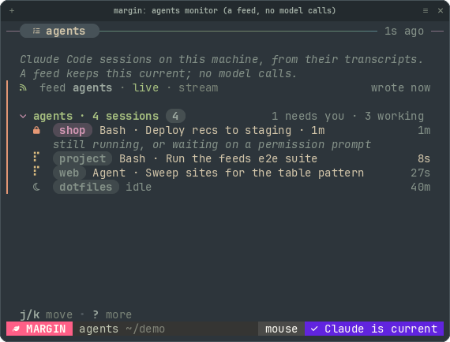
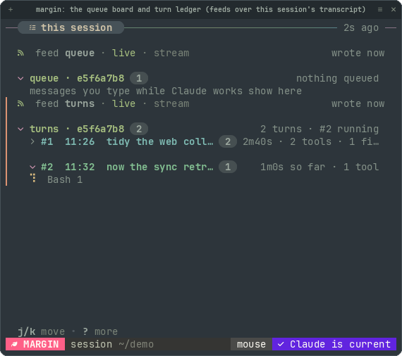

---

## 8. Use cases, pushed

Ranked by value to sulin's actual pattern (queues many messages, reads one line, hops tabs) times feasibility, merging landscape.md §5 and the coordinator's seed list. Each one doubles as a requirement: the last column names what it stresses in the framework.

| # | use case | value | blocks | interactions | stresses |
|---|---|---|---|---|---|
| 1 | **Plan / progress** that the AI ticks as it works | sulin sees where a long turn is without scrolling | section, todo, progress, timer, status | tick, fold | shared field, reconcile, timers |
| 2 | **Decision inbox**: questions with defaults instead of buried mid-paragraph | he answers with a double-click; the AI never blocks | question, text | pick | answer slot ownership, `wait`, events |
| 3 | **Turn ledger**: what changed each turn, from jj, with revert proposals | catches surprise edits; replaces "what did you touch?" | section, diff, link | verdict, open | difftastic, jj, derived content |
| 4 | **Assumptions and decisions** he can strike | the cheapest correction there is | claim, question | strike, pick | events into the next prompt |
| 5 | **PR review desk**: findings with structural diffs, hunk verdicts | review in place; verdicts become the AI's work list | finding, diff, section | verdict, step | diff widget, hunk navigation |
| 6 | **Inbox of his queued messages**: each one closed with an outcome | nothing he said gets lost | todo-like rows | jump | reading queued prompts (hook) |
| 7 | **Agent monitor** | "who needs me?" in one place | agent, log, table | expand, answer | live sources, polling, tokens to other sessions |
| 8 | **Research board**: pinned findings with warrant | the answer and its evidence persist past compaction | claim, link, section | pin, strike | warrant type, persistence |
| 9 | **Explainer with a stepper and a check question** | learning by the mechanism, his stated style | text, graph, question | step, pick | images (kitty), graph highlight per step |
| 10 | **Debug board**: hypotheses → evidence → status | stops the AI circling one theory | claim, table | strike, pin | claim states |
| 11 | **Context gauge** and what's in context | anticipate compaction; see what the AI read | progress, table | — | statusline/transcript source |
| 12 | **Session summary** pinned float | re-entry after a tab hop | text | dismiss | the float shape |

The strongest new ones have mockups:

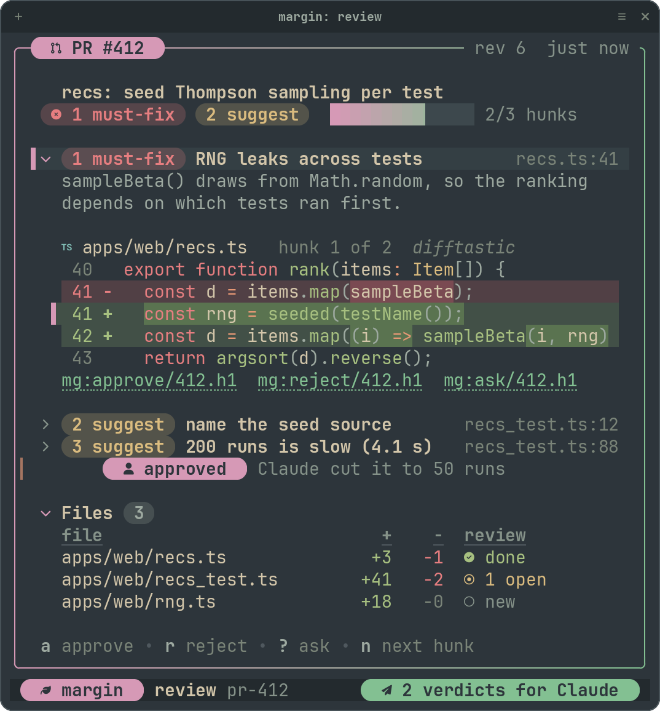
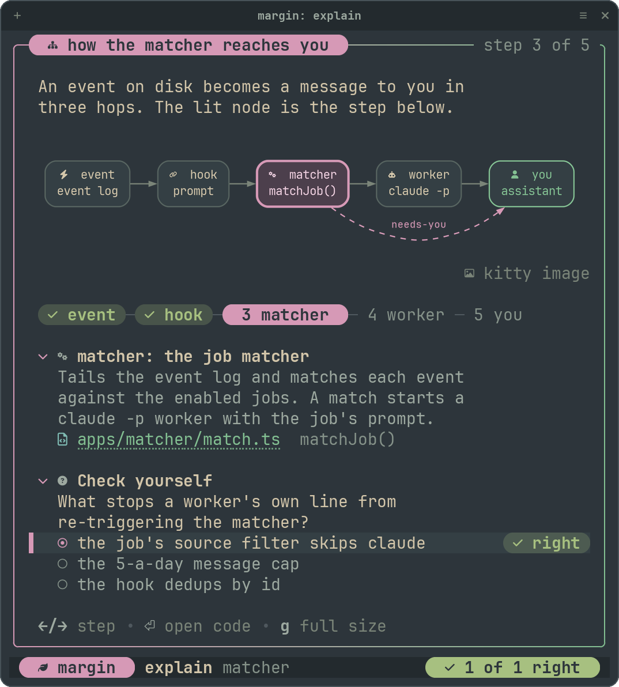
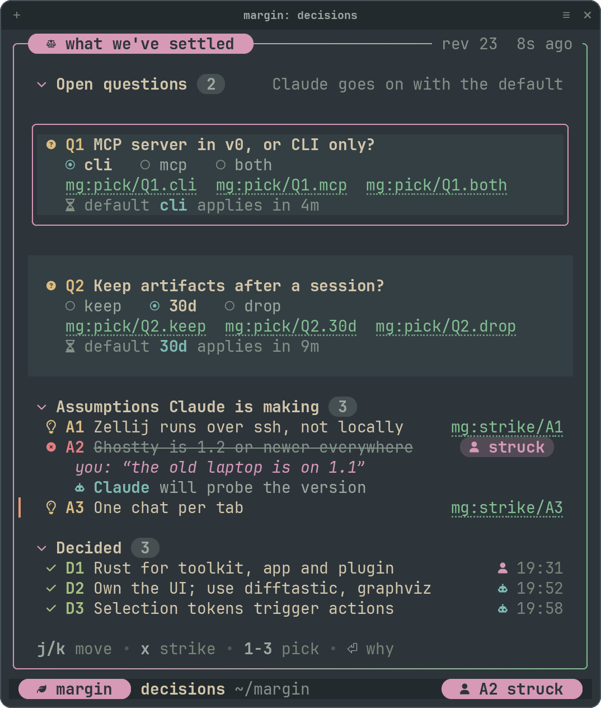
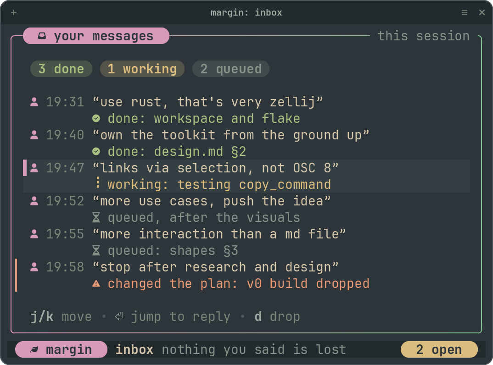
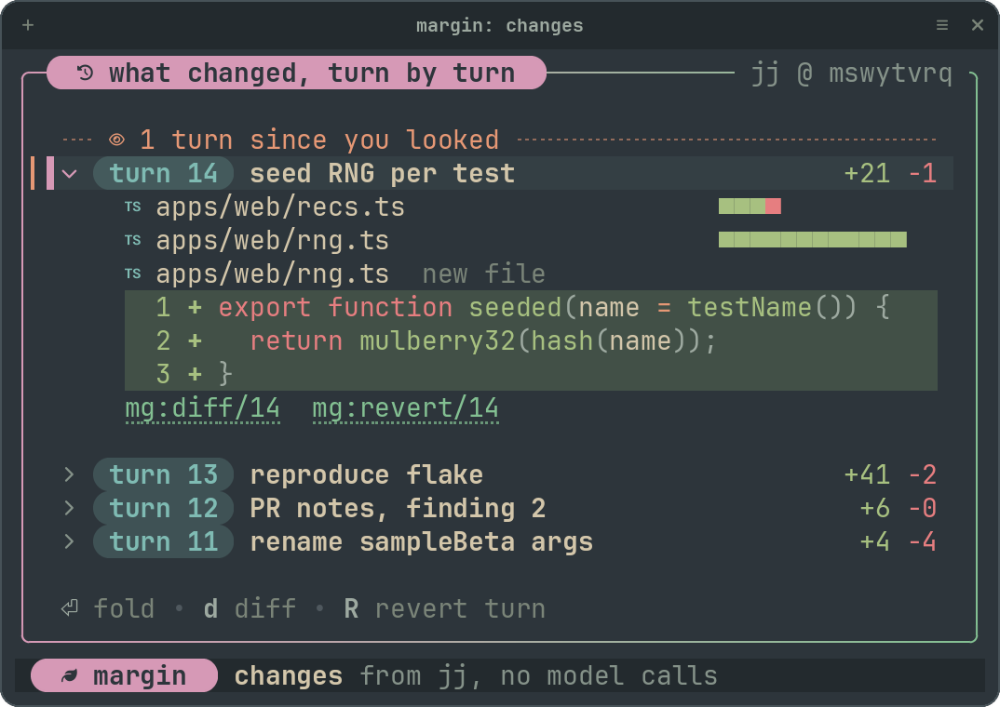
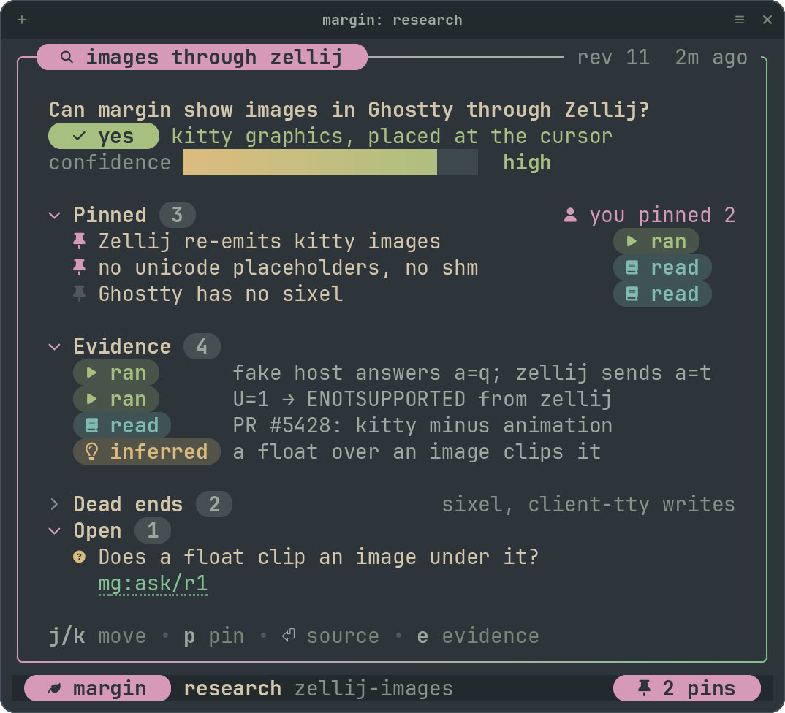

**Kept for later, and why not now.** Data exploration (a table plus a chart the AI refines) needs a chart component and a data source protocol. A shared scratchpad where both write needs text editing inside the pane, a big lift on its own. Meeting notes from the day's sessions and timeline replay are batch jobs over transcripts that render into ordinary documents, so they need no new framework capability. Dashboards for other projects (a status digest, charts) are good *consumers* once images and live sources exist; they shape nothing new.

**Dropped.** A "teach me" glossary as its own artifact: a `kv` section in the explainer does the job. Quizzes beyond one check question: a quiz that gates progress turns a working surface into homework.

**What shapes the v0 core.** Use cases 1, 2 and 4 together need every load-bearing mechanism: typed components with ids, the three owners, the event log, the prompt hook, selection tokens, pane anchoring and reconcile-without-losing-place. 5 adds the diff component, and 9 adds images. So v0 is **plan + decision inbox in one artifact kind, plus a diff block and one image**: small, and it proves everything.

---

## 9. v0 scope (when sulin says go)

A smaller, solid slice on our own stack:

1. `vellum`: term, input (including swallowing kitty replies), grid with damage diff and 2026, text (NFC, wrap), a flow layout, the frame clock with springs and eases, kitty image at the cursor plus the halfblock fallback.
2. `margin`: the store (lock, rename, rev, history, events), the ops (`put add set rm show events wait`), `open`/`close` via `zellij action`, `view` (the renderer), `render` (headless), `select` (the dispatcher).
3. Components: section, text, todo, progress, timer, status, question, diff (difftastic JSON, side-by-side or inline by width, read-only verdict tokens), image, link.
4. The prompt hook script and the skill (`skill/SKILL.md`), not installed.
5. Tests: unit tests for the input parser, width and wrap, grid diff, reconcile and the token grammar; snapshot tests via `margin render`; an e2e script that runs a Zellij session with the fake Ghostty host from research.md, opens a float in a background tab, checks focus and the active tab didn't move, double-clicks a token through the host's stdin, and asserts that `state.json` and `events.jsonl` changed.

**Not verifiable from here, so it needs sulin's eyes:** how the kitty image actually looks in Ghostty through Zellij, whether a float over an image clips it, animation smoothness, and the real feel of double-click-to-act.

---

## 9b. v0 as built (2026-11-05)

Built as specified above, with these calls changed by evidence or by sulin's review:
- **Default pane: split, not float.** A double-click acts in one gesture only on a split with `mouse_click_through` (research §8). `--float` stays available for glanceable artifacts.
- **The status bar copies Lip Gloss's layout example**: a #353533 band, a pink key block, violet nuggets on the right.
- **Mid-turn delivery exists now**: `margin hook post-tool` emits `additionalContext` (research §7), next to `margin hook prompt`.
- **Assumption lines (`claim`) moved to v0**, as sulin asked.
- Real renders: `docs/img/real/` (feeds: `feed-agents.webp`, `feed-jj.webp`, `feed-queue.webp`, `feed-crash.webp`), made by `tests/e2e/capture_feeds.py`.
- **2026-11-06: hosts (§6b) and feeds (§7b).** Building feeds exposed a renderer bug: a removed section's rows never finished collapsing (the draw loop re-created their retained nodes) and sibling ghosts drew in reverse order. Fixed in `scene.rs`, with a regression test.

## 10. Open questions for sulin

1. **Where does Zellij run when you chat with Claude?** If Zellij runs on the laptop and Claude Code runs over ssh inside it, margin and the store must live where Zellij runs, so the design holds; but the opener and clipboard choices flip. Also: a web terminal path (ttyd → xterm.js → `zellij attach web`) has no kitty graphics, so images there fall back to halfblocks [inferred: xterm.js's image addon speaks sixel and iTerm2, not kitty].
2. **Selection plugins**: does a Zellij plugin that receives selections get them from `copy_command` or from a plugin API I didn't find? If the latter, margin should copy its approach.
3. **Setting `copy_command "margin select"` globally** changes how every copy in Zellij works (the dispatcher passes plain text through to the clipboard). OK to set it, or only in a margin layout?
4. **Artifacts' lifetime**: keep them per project forever (cheap), or archive after N days untouched?
