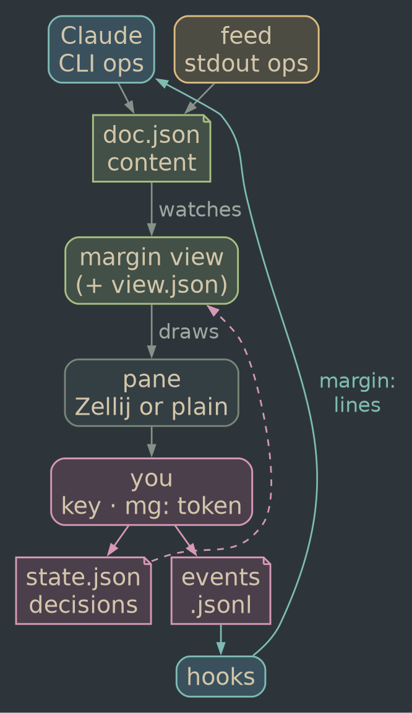
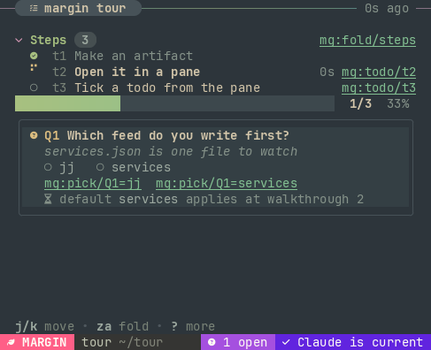

# margin, the tool

*A hands-on guide, checked against the debug build on 2026-11-06; the walkthrough commands, their output and the screenshots were re-run on 2026-11-10. Headings marked (fold) are reference sections you can skip on a first read; numbered `[ ]` steps are a checklist.*

margin is a folder of JSON files plus programs that write and draw it. You, Claude and small scripts all write into one board, and a pane draws it live. Your ticks and picks flow back to Claude on its next turn. Learn the model below, then type the four walkthroughs: about 30 minutes, no Claude needed until the third.

## The model



- **The store is the truth.** Each board is a folder under `~/.local/state/margin/<project>/`. `doc.json` holds content, `state.json` your decisions, `view/<pane>.json` each pane's folds and scroll, and the project's `events.jsonl` logs everything you did.
- **Writers send ops, never files.** Claude runs `margin add/set/rm …` through its Bash tool. A feed prints the same ops as JSON lines, and the daemon applies them. You write only decisions: a key in the pane, or a double-clicked `mg:` token.
- **The view only reads.** `margin view` watches the store and redraws. Nothing ever talks to the pane, so a hundred writes cost no pane churn.
- **The return path is the hooks.** Claude Code runs `margin hook prompt` before each of your messages and `margin hook post-tool` after each tool call. Each prints your unread events as `margin:` lines, once per session.[^hook]
- **The Host decides where the pane lives.** It's a split or float in Claude's Zellij tab, or (`plain`) any terminal you run `margin view` in.

## Words you'll meet

| word | means |
|---|---|
| board | one document, named by you: `plan`, `tour`, `agents` |
| project | the jj/git root you ran `margin` in, as a slug; boards belong to it, not to a session |
| component | a typed block with an `id`: `{"type":"todo","id":"t1","text":"…"}` |
| op | one change to content: `add` `set` `rm` `move` `title` `replace` |
| rev | the board's revision; every content write bumps it |
| owner | who may write a field: Claude, you, the pane, or a feed |
| event | one line in `events.jsonl`: what you did, when, through what |
| token | `mg:verb/id=value`: text that acts when selected |
| feed | a registered script whose stdout keeps part of a board current |
| daemon | the per-project process that runs feeds |
| host | where panes go: Zellij or plain |

### Components (fold)


| type | fields you write | you act |
|---|---|---|
| `section` | `title` `note` `children` `folded` `tone` | fold (⏎, or click the header) |
| `text` | `text` `style`: note, dim, warn; `tone`; `**bold**` and `` `code` `` inline | — |
| `bullet` | `text` `tone`, sub-bullets as `children`; inline markup | — |
| `todo` | `text` `note` `status`: todo, doing, done, blocked | tick (space) |
| `progress` | `of` (a section id) or `value` 0–1, `label` | — |
| `timer` | `since` or `until` (RFC 3339), `label` | — |
| `status` | `text` `state`: running, pass, fail; `result` `spark` `target` | open (⏎) |
| `question` | `text` `options` `default` `why` `applies` `applied` | pick (1–9) |
| `claim` | `text` `ack` | strike (x) |
| `decided` | `text` `by`: claude or you, `at` | — |
| `link` | `text` `target`: a URL or an `mg:` token | open (⏎) |
| `image` | `path` (PNG) `alt` `rows` | — |
| `diff` | made by `margin diff` | approve (a), reject (r) |
| `row` | `text` `glyph` `tag` `aside` `since` or `meta` `detail`, tones | — |
| `feed` | written by the daemon: a feed's health line | — |

An unknown `type` draws as a red "unknown component" line instead of failing, so a typo shows up on screen.

### Owners and ops (fold)

Four owners, enforced by the store on every write (`store.rs` `check_owner`):

- **Claude** (any `margin` CLI write, whoever types it) owns content in `doc.json`.
- **You** own decisions in `state.json`: ticks, picks, strikes, verdicts, pins. The CLI can't write them.
- **The pane** owns `view/<pane>.json`: folds, focus, scroll. A content rewrite never resets them, because the renderer matches components by id.
- **A feed** owns the ids `P` and `P-…` for its `--owns` prefix `P` in its board (`ci` owns `ci-1`, not `city`). Claude's writes there fail, and its writes elsewhere fail.

Todo `status` is the one shared field: Claude's `margin set plan t1 status done` and your space bar both land in `state.json`, and the latest wins. Both use one vocabulary: `todo doing done blocked skipped next` (and `clear` drops your mark).

The ops, as JSON. `margin apply` reads them on stdin, and a feed prints them, one value per line:

```json
{"op":"add","parent":"steps","block":{…},"after":"t2"}
{"op":"set","id":"t1","fields":{"note":"…","status":"doing"}}
{"op":"rm","id":"t1"}
{"op":"move","id":"t3","before":"t1"}
{"op":"title","value":"new title"}
{"type":"todo","id":"t4","text":"…","parent":"steps"}
{"v":1,"title":"plan","blocks":[…]}
```

A bare component is an upsert: it replaces the component with that id in place, or adds it to `parent` (default: the top level). The last line is a whole document (`apply` only): it replaces the one there. All of these are updates to a board that exists; `margin new` is the one command that creates one, and a write that names a missing board fails with `create it with margin new <board>` and the nearest existing name. `set` with a `null` value removes the field; `"field":"note","value":"…"` still works for one field. Several lines, or an array, are one write: all land or none do. `margin schema` lists every type's fields and allowed values, and a write that names an unknown field or value fails with a suggestion. Any write can carry `--base-rev N`; if the board moved on, the write fails instead of landing on the wrong thing:

```text
margin set: stale base: you edited rev 3 but the board is at rev 9;
run `margin show` and redo the change on rev 9
```

### Tokens and events (fold)

A token is `mg:<verb>/[<board>.]<id>[=<value>]`. The pane prints the short form (no board) and resolves it to the board holding that id.

| token | does |
|---|---|
| `mg:todo/t3` (or `tick`) | toggles done; `=doing` sets a status |
| `mg:pick/Q1=jj` | picks an option, by text or 1-based number |
| `mg:strike/A1=it-is-hourly` | strikes a claim; dashes in the reason become spaces; again unstrikes |
| `mg:approve/d1` `mg:reject/d1` `mg:ask/d1` | a verdict on a diff |
| `mg:pin/x` | toggles a pin |
| `mg:open/L1` | opens a link's URL or runs its token; a board name opens its pane |

Each one appends an event. Passive kinds (`view`, `fold`, `seen`, `open`, `feed`) are logged but never handed to Claude; `margin events --all` shows them.

## Walkthrough 1: a board by hand

No Claude, no Zellij. You need two terminals.

1. [ ] **Put `margin` on PATH and make a scratch project.** [install.md](install.md) covers installing it; for a dev build, alias it for this shell from the repo's root:

   ```fish
   alias margin $PWD/target/debug/margin
   mkdir -p /tmp/margin-tour; cd /tmp/margin-tour
   ```

2. [ ] **Create the board.** `new` makes it (and refuses a name that already has one); `add` creates one component at a time. Each prints the new rev. Every write after `new` is an update and fails on a name with no board, so a typo can't make a second board.

   ```fish
   margin new tour --title "margin tour"
   margin add tour - section steps title=Steps
   margin add tour steps todo t1 "Make a board"
   margin add tour steps todo t2 "Open it in a pane"
   margin add tour steps todo t3 "Tick a todo from the pane"
   margin add tour - progress p of=steps
   ```

   `-` means top level. Extra `key=value` words become fields (values parse as JSON, else text); a bare word becomes `text`.

3. [ ] **Ask a question with a default, and mark progress.**

   ```fish
   margin ask tour Q1 "Which feed do you write first?" \
     jj services --default services \
     --why "services.json is one file to watch" \
     --applies "at walkthrough 2"
   margin set tour t1 status done
   margin set tour t2 status doing
   ```

4. [ ] **Open it.** Outside Zellij the host is `plain`, so `open` tells you what to run:

   ```text
   $ margin open tour
   no multiplexer (host plain): run this in a terminal beside the chat:
     margin view tour --project tmp-margin-tour
   ```

   Run that in the second terminal (with the binary's full path if `margin` isn't on PATH there). `q` quits.

   

5. [ ] **Tick t3 and pick an option with keys.** `j`/`k` move focus, and the help line at the bottom shows what the focused component takes: `space` on a todo, `1`–`9` on a question, `x` on a claim. With the plain host the mouse is on, so a click on a token works too.

   

6. [ ] **Read what you did back.** This is exactly what Claude gets:

   ```text
   $ margin events
      1 11:34:28 the user marked tour.t3 “Tick a todo from the pane” done: they did it themselves, so don't redo it
      2 11:34:28 the user picked services for tour.Q1 “Which feed do you write first?”
   ```

   "the user" becomes your name once `user_name` is set in the config (`margin init --user-name <you>`).

   `margin show tour` prints the content with your decisions merged in, and `--json` gives both files raw. A token typed at the shell does the same as a key: `margin select mg:todo/t2`.

## Walkthrough 2: a feed from scratch

A feed is any program that prints JSON lines. This one turns a `services.json`, the kind of status file a monitoring job rewrites, into one row per service.

1. [ ] **Make the data and write the script.** In `/tmp/margin-tour`, a sample `services.json`:

   ```json
   {"services": [
     {"name": "web",    "ok": true,  "note": "all 6 checks pass", "since": "2026-11-10T09:12:00Z"},
     {"name": "api",    "ok": true,  "note": "all 4 checks pass", "since": "2026-11-10T11:58:00Z"},
     {"name": "backup", "ok": false, "note": "last run failed"}
   ]}
   ```

   and the feed, `services-feed` (`chmod +x` it):

   ```bash
   #!/usr/bin/env bash
   # margin feed: one row per service in services.json
   set -euo pipefail
   jq -c '{
     type: "section", id: "svc", title: "services",
     children: [ .services[] | {
       type: "row", id: "svc-\(.name)",
       glyph: (if .ok then "done" else "fail" end),
       text: .name, aside: .note, aside_tone: "grey"
     } + (if .since then {since: .since} else {} end) ]
   }' services.json
   ```

   Run it bare first: it should print one long line starting `{"type":"section","id":"svc",…`.

2. [ ] **Register it.** Pick the trigger that matches the data: another program rewrites this file, so watch it.

   ```fish
   margin feed add services --watch services.json \
     --board tour --owns svc -- ./services-feed
   ```

   It prints `feed services: watch services.json → tour (owns "svc"); daemon started`. The command runs from this directory, without a shell.

3. [ ] **Check it.** `margin feed ls` shows `live` and "ran 2s ago · wrote"; your pane grows a health line and the section. Edit `services.json` and the section follows.

    tick in the renderer; the feed never rewrote them. Real render through pyte, not Ghostty.")

4. [ ] **Test changes with `feed run`, read errors with `feed logs`.** `margin feed run services` runs it once in the foreground and prints `tour rev N` or `tour unchanged`. stderr and rejections go to the log:

   ```text
   $ margin feed logs services
   2026-11-10T19:34:12Z start: ./services-feed (watch services.json)
   ```

5. [ ] **Pause, resume or remove it.** `margin feed pause services`, `resume`, `rm`. After `rm` the last output stays in the board and the health line says "removed"; the daemon exits when no feed is left.

### Line formats (fold)

Each stdout line is one of three things:

- **A whole component** (`{"type":…,"id":…}`): replaces the component with that id, or appends it. The usual feed write: print your whole section every run.
- **One op** (`{"op":"set",…}`): for a small change.
- **An array of ops**: all or none. If one op fails (say an `rm` of an id that isn't there yet), none apply and the log says why.

Blank lines and lines starting with `#` are skipped. A line that writes outside the prefix is rejected and logged; the feed's other lines still land:

```text
rejected: feed clk may only write ids starting "clk"; "t1" is outside its prefix
```

Lines from one interval or watch run land as one revision. A stream's lines land as they come, at most one write per `--min-gap` (default 1 s).

### Why `since` beats an age string (fold)

Write `"since": "2026-11-06T14:33:12Z"` on a row, never `"aside": "3h ago"`. The renderer turns `since` into a live age that ticks on its own. Your output then stays byte-identical until something real changes, and the store skips the write: `feed run` says `tour unchanged` and no revision is made. An age string changes every run, so each run costs a revision, a redraw and a change bar for nothing. The `jj` and `agents` feeds both work this way.[^feeds]

### Triggers (fold)

| trigger | runs | use it for |
|---|---|---|
| `--every 30s` | the command each interval | anything you'd poll |
| `--watch <path>…` | once at start, then on each change (250 ms debounce) | files another program writes |
| `--stream` | one long-running process | a loop that prints only on change |

`--timeout 60s` kills a run that hangs. A crash restarts after 1, 2, 4 … 60 s, and 30 s of health resets the backoff. `--replace` re-registers a feed under the same name. `feeds/jj` (watch) and `feeds/agents` (stream) in this repo are the worked examples; their header comments explain each choice.

## Walkthrough 3: with Claude

1. [ ] **Start a wired Zellij session.** Run `margin session` (or `margin session NAME`). It starts Zellij with a one-tab layout and session-only options: `copy_command "margin select"`, copy on select, and mouse click-through. Your own `config.kdl` stays untouched. Without these options a double-click on a token only copies it.

2. [ ] **Run `claude`.** `margin init` ([install.md](install.md)) puts the hooks in `~/.claude/settings.json`, so every session gets your clicks back. Before `init`, only a project whose own `.claude/settings.json` carries the hooks does.

3. [ ] **Ask for it in words.** The skill only acts on request: "start a margin for this", "track this", "keep a plan up", "watch the agents". On a long task Claude may offer once in one line. It then `put`s a plan, runs `margin open plan` (a split in its own tab; your focus doesn't move) and ticks steps as it works.

4. [ ] **Act in the pane.** Double-click a token, or focus the pane and use keys. The card says "sent".

5. [ ] **Watch it come back.** At your next message, or after Claude's next tool call mid-turn, the hook prints:

   ```text
   margin: the user acted in the margin pane since your last look (2 events).
   Their decisions are binding; `margin show <board>` for context.
   - the user marked tour.t3 “Tick a todo from the pane” done: they did it themselves, so don't redo it
   - the user picked services for tour.Q1 “Which feed do you write first?”
   ```

   It shows at most 8 lines, and each session gets each event once. When nothing happened it prints nothing.

### What the skill tells Claude (fold)

- **Content is Claude's, decisions are yours.** To change something you decided, it says so in chat.
- **Never block on a reversible fork.** It posts `margin ask … --default X --applies "<when>"`, carries on with the default, and checks events at that point. To block on an answer from a script, follow the log: `margin events --follow --name pick --board plan --json` (see `margin help integrate`).
- **A struck claim gets an answer:** re-check, then `margin set <board> <id> ack "…"`.
- **Address by id, base on a rev** (`--base-rev`), and treat `margin:` lines as your input.
- **Feed-owned ids are read-only,** and anything you want kept current becomes a feed, not a poll each turn.

## Walkthrough 4: a feed and Claude in one board

Walkthrough 2 already did this: `tour` holds your steps and the `svc` feed. The prefix is the whole contract.

1. [ ] **Give the feed a prefix nothing else uses.** `--owns svc` gives it every id starting `svc`, including its health line `svc-feed`. Leave out `--owns` and the prefix is the feed's name; `--owns '*'` takes the whole board.
2. [ ] **Keep Claude's ids outside it.** `margin show tour` starts with `(feed services owns the ids svc and svc-…: read-only for you)`, and a write inside fails with the way out:

   ```text
   $ margin set tour svc-web text hello
   margin set: "svc-web" belongs to feed `services`, which owns the ids
   svc and svc-… here and rewrites it on its own; write outside that
   prefix, or stop the feed first (`margin feed pause services` /
   `margin feed rm services`)
   ```

3. [ ] **Let Claude arrange around it.** Claude can add, move and remove its own components above or below the feed's section; a whole-document `apply` must carry the feed's components through unchanged. Registering a feed over ids Claude already wrote hands them over, with a note (`note: feed clk now owns 3 existing ids (…)`).

## Cheat sheet

### Content (fold)

| command | does |
|---|---|
| `margin new A [--title T] [--purpose P] [< doc.json]` | create a board: empty, or from a whole doc (a bare array is the block list); refuses one that exists |
| `margin apply A [--base-rev N] [--json] < in` | update (state from a script): ops, components (upsert by id), or a whole doc (replaces); all or none; A must exist |
| `margin schema [TYPE] [--json]` | the component types, fields and allowed values every write is checked against |
| `margin add A PARENT\|- TYPE ID [text…] [k=v…]` | create a component (an id that exists is refused); every bare word is text; `--before X`/`--after X` |
| `margin set A ID FIELD VALUE` or `A ID k=v…` | change a component's fields (a missing id is refused), typed by the schema (text stays text) |
| `margin rm A ID` | remove (decisions on it show as orphaned) |
| `margin rm A [--yes]` | remove a whole board: a preview without `--yes`; with it, its feeds are unregistered and it moves to `.archive/` |
| `margin move A ID --before X\|--after X\|--parent P` | reorder |
| `margin title A "T"` | rename |
| `margin ask A ID "Q" opt… --default D` | a question; `--why` `--applies` `--parent` |
| `margin diff A ID --old F --new F [--path L]` | a difftastic diff block |
| `margin diff A ID --rev R [--to R2] FILE` | the same from jj revisions |
| `margin image A ID x.png [--alt] [--rows N]` | a PNG |
| `margin show A [--json]` | content + your decisions |
| `margin ls` / `margin gc [--days N]` | list; archive untouched ones (30 days) |

Every write takes `--base-rev N`. Every command takes `--home DIR`, `--project NAME` and `--by you|claude|NAME`, before or after the command (who the write is logged as; default claude inside Claude Code, you elsewhere), and `margin CMD --help` (or `-h`, or `margin help CMD`) prints its usage without acting. A flag a command doesn't take is refused before it runs.

### Return channel and screen (fold)

| command | does |
|---|---|
| `margin events` | your actions; `--unread --session S`, `--board`, `--since N`, `--kind K`, `--all`, `--json` |
| `margin hook prompt\|post-tool` | the hooks (JSON on stdin) |
| `margin open A [--float\|--split\|--stacked] [--tab-id N]` | place the pane (Zellij) or print the view command (plain; an absolute path when `margin` isn't on PATH) |
| `margin panes A` / `margin close A` | where it shows / close it |
| `margin view A` | the renderer itself |
| `margin render A --width W --height H [--ansi]` | one frame to stdout, no terminal |
| `margin select [TEXT]` | apply a token, open a URL, or copy |
| `margin session [NAME]` | a wired Zellij session |
| `margin demo [live]` | a sample plan, then a live turn |

### Feeds (fold)

| command | does |
|---|---|
| `margin feed add N --every 10s\|--watch P…\|--stream -- CMD…` | register; `--board` (it must exist: a feed never creates one) `--owns` `--min-gap` `--timeout` `--replace` |
| `margin feed ls` | state, trigger, restarts, last run and its outcome |
| `margin feed run N` | once, in the foreground; leaves the daemon's status alone |
| `margin feed logs N [--follow] [--lines N]` | stderr and the daemon's notes |
| `margin feed pause\|resume\|rm N` | stop or start it; `rm` keeps its last output |
| `margin daemon` | the supervisor; the CLI starts it for you |

### Keys in the pane (fold)

| key | does |
|---|---|
| `j` `k` / arrows | move focus; a count repeats it (`5j`) |
| `gg` `G` | top / end |
| ctrl-d ctrl-u, ctrl-f ctrl-b, PgDn PgUp | scroll half / whole pages |
| `]]` `[[` (or `}` `{`) | next / previous section |
| `za`, `zc` `zo` (or `h` `l`) | toggle, close, open the focused section |
| `zM` `zR` | fold / unfold every section |
| `/` then `n` `N` | find as you type (Enter keeps it, Esc drops it); next / previous match |
| `⏎` or space | the focused row's action: fold a section, open a link, cycle a todo |
| `1`–`9` | pick a question's option |
| `x` | strike or unstrike a claim |
| `a` `r` | approve or reject a diff |
| `c` | review mode: drag picks a quote, a click picks a row; then `+` more, `-` less, `=` keep, `!` disagree, `?` why (or click a pill); the same reaction again takes it back; Esc leaves |
| `o` | take the focused step as yours, or hand it back (your steps: the circle goes open → done → open) |
| `i` | show every row's id (todos, questions and claims always show short ones) |
| `m` | mouse reporting on or off |
| `?` | more keys |
| `q` | quit |

A half-typed count or sequence shows in yellow at the help row's right and drops after a second, like vim's `showcmd` and `timeoutlen`.

### Dependencies (fold)

Give a todo `after: ["t1", "t2"]`, the steps in its section it waits on, and the section draws
its todos as a graph in Flog symbols (rbong/flog-symbols, U+F5D0–U+F60D; your terminal's font needs
them): a node per step, filled when done and hollow when open, lines down to the steps that wait
on it, branches and merges. The node is the step's button: a click cycles it. `graph.rs` lays it
out; an edge can only run down the list.

### Steps that rest on a claim (fold)

A todo with `rests_on: ["A1"]` carries a dim `A1` tag. Strike A1 and every open step resting on
it turns red (its glyph or graph node, its lines, a `✗ A1` tag); Claude's line about the strike
lists those steps. Unstrike it and they go back.

### Recap and read-back (fold)

Claude Code writes a session recap when you return to a terminal you left (`/recap` asks for one;
`/config` turns it off). The hooks pick the newest one out of the transcript and the pane shows it
as its first row, `↺`, for six hours. After a compaction or a resume, the session-start hook asks
Claude for a read-back instead: 2–3 claims in a `readback` section at the top, which you strike if
they're wrong.

### When Claude goes ahead (fold)

A question card says when its default will be taken: "taken when t4 starts" when its `applies`
names a step (that step shows `? Q1`), a countdown when it has `takes_at`, "taking the default now"
in yellow once the moment comes, and the time Claude took it once it has. **wait for me** holds it:
Claude stops at that step and waits for your pick; **release** lets the default stand.

### Toasts (fold)

`margin toast <board> "text" [--at ID] [--level ok|info|warn|error] [--ttl SECS]`: a message that
goes away by itself. It's a full-width box with a border in its level's colour, at the bottom of
the pane over the content; two show at once, the oldest lowest and the newer one above. Its bottom
edge drains as time runs out; the time starts once the pane has been on screen; an error waits for
a click; a click dismisses any. `--at` names the row it's about (shown on its right). Feeds send
one with a line `{"toast": "…", "level": "ok", "at": "<id>"}`. Stored in the project's `toasts/`,
not in the doc.

### Waking Claude (fold)

When Claude is idle and you finish in the pane (quiet 5 s, no question set half answered, review
mode off; or a minute of quiet regardless), margin wakes it. The `Stop` hook `margin hook rewake`
does it: Claude Code runs it in the background as a turn ends (`"asyncRewake": true`), it waits for
you to finish, then exits 2 with your decisions on stderr, and Claude Code hands those to Claude
as a system reminder and starts a turn. It leaves quietly when you send a message first, and
after 58 minutes.

Without a live watcher (hooks installed before it existed, the hour passed, a Claude Code without
`asyncRewake`) the pane falls back to one line written into the session's inbox, the Unix socket
Claude Code gives every session for messages between sessions; your actions then arrive through
the hooks. Claude Code presents that line as another session's message and, in some permission
modes, holds it for your approval (`"crossSessionInbound": "accept"` in its settings lets it
through). The hook keeps the socket and token in `$XDG_RUNTIME_DIR/margin/` (0600, memory-backed).
`"wake"` in the config picks the route: `auto` (the default), `hook`, `inbox`, or `off`.

### Config and files (fold)

`~/.config/margin/config.json` (or `$MARGIN_CONFIG`); every key is optional.

| key | default | what |
|---|---|---|
| `user_name` | the user | your name in what margin tells Claude ("sulin picked cli") |
| `graph_glyphs` | box | box (box-drawing, any font) or flog (Flog symbols, U+F5D0–U+F60D; the font needs them) |
| `wake` | auto | wake an idle Claude when you finish in the pane: auto (the rewake hook, else the inbox message), hook, inbox, off |
| `host` | auto | zellij, plain, auto (Zellij when `$ZELLIJ_SESSION_NAME` is set) |
| `pane` | split | default shape for `open`; or float |
| `motion` | on | off stops every animation |
| `motion_slow` | 1.0 | 2.0 = half speed |
| `images` | auto | kitty, blocks |
| `mouse` | false | start with mouse reporting on |
| `opener` | auto | URL opener; auto uses `opener` over ssh |
| `clipboard` | auto | wl-copy, osc52, none |
| `archive_days` | 30 | 0 = never |
| `ring` | flow | focus border: flow, static, plain |
| `fps` | 30 | frame ceiling while animating |
| `difft` | — | difftastic's path for `margin diff` when no `difft` is on PATH |

Also `float_x` `float_y` `float_width` `float_height`, `ring_period`, `pulse_breaths`, `pulse_period`, `status_style`.

Environment: `MARGIN_DIFFT` names difftastic outright; `MARGIN_HOST`, `MARGIN_MOTION`, `MARGIN_IMAGES` override the file; `MARGIN_HOME` moves the store (default `~/.local/state/margin`); `MARGIN_PROJECT` forces the project; `--home` and `--project` do the same per command.

```text
~/.local/state/margin/<project>/
  events.jsonl (+ events.1.jsonl, events.seq)  .lock  cursors/<name>  delivered/<session>
  feeds.json  feeds/<name>.log  daemon.lock
  <board>/doc.json  state.json
            view/<pane>.json
  select.log   (at the top: every selection)
```

## Extending it

### A new component type (fold)

Everything lives in `crates/margin/src`. A type is a row in `doc.rs` `SCHEMA` (its fields, their types and allowed values, whether it holds children): every write is checked against it, so an unknown `{"type":"x"}` is refused until it has one. Then make it draw and act:

1. [ ] **Declare it:** a `Kind` in `doc.rs` `SCHEMA`; `margin schema x` then prints it.
2. [ ] **Draw it:** add an arm to `components.rs` `draw`, built from vellum's parts (`crates/vellum/src/parts.rs`: pill, tag, progress, help line, ring) and the `put`/`right`/`tok` helpers. Return a `Drawn` at its natural height; the scene animates it.
3. [ ] **Make it focusable or not** in `scene.rs` (the `focusable` match), and list its keys in the scene's help line.
4. [ ] **Give it keys** in `app.rs` `key`, calling `self.decide(id, kind, value)` so the decision lands in `state.json` with an event.
5. [ ] **Give it a token** if you want double-click: a verb in `select.rs` `VERBS` and an arm in `apply_token`.
6. [ ] **Teach Claude to read it:** a line in `main.rs` `show_text` and, for a new event kind, `hook.rs` `describe`.
7. [ ] **Test it headless:** `margin render` plus a snapshot test like the ones at the bottom of `scene.rs`.

### A new Host (fold)

`host.rs` holds the `Host` trait: `open`, `find`, `close`, `is_visible` (for "seen"), `selection` (copy-command or in-pane) and `session`. `ZellijHost` and `PlainHost` are the two impls. A tmux host is one more impl plus an arm in `host::pick` and a config value; nothing in vellum or the store changes.

### Feeds in any language (fold)

The daemon runs argv with no shell, in the directory you added it from, and reads stdout lines. Deno, Python and Rust all work: print one JSON object per line and flush. A stream feed should flush per line and print only on change. Keep feeds read-only towards the world. A feed that writes to what it watches retriggers itself forever; that's why `feeds/jj` reads with `--ignore-working-copy`.

## Limits today

- **A dev build of `margin` is on PATH only inside the repo** (through direnv) until you install it. `margin init` writes absolute paths into the hooks and the skill, so nothing depends on PATH; `margin open` under the plain host prints the absolute path when `margin` isn't on PATH.
- **Hooks need `margin init`.** It installs them for every project ([install.md](install.md)). A session without them writes boards fine, but your clicks reach it only through `margin events`.
- **Double-click tokens need `margin session`.** In a plain Zellij session the selection is only copied. In the plain host, keys and mouse clicks in the pane work.
- **`margin diff` needs difftastic.** The nix build wraps it in; a dev build looks in `$MARGIN_DIFFT`, then PATH, then config `difft`, then the nix profile dirs, and names those fixes when it finds none.
- **Nothing is checked in Ghostty yet.** Every render here went through pyte, a fake terminal: kitty images, colours and the feel of double-click need your eyes.
- **The agents feed can't see permission prompts.** A tool call pending over a minute shows "running or waiting on permission"; a Notification hook would make it exact.[^agents]
- **The design doc runs ahead of the build.** `margin propose`, `p` to pin, and `n`/`N` across diff hunks are designed but not built; design.md marks them so.
- **A todo `status` write doesn't bump `rev`.** It lands in `state.json`, so `--base-rev` doesn't guard it (api-review.md §3).

[^hook]: [research.md](research.md) §7 (PostToolUse `additionalContext` reaches the model on its next call) and design.md §7b: with a feed writing 20 revisions a second, `margin hook prompt` took a median 2.2 ms, max 8.9 ms.
[^feeds]: [design.md](design.md) §7b, and `store.rs` `feed_write`: a feed write that leaves the blocks and title equal makes no revision.
[^agents]: [design.md](design.md) §7 and the header of `feeds/agents`: "the transcript can't tell those apart".
