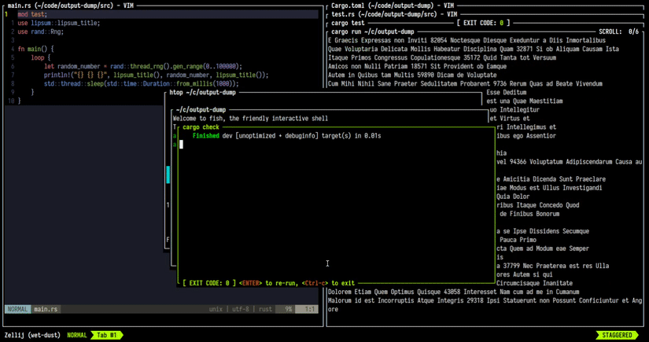
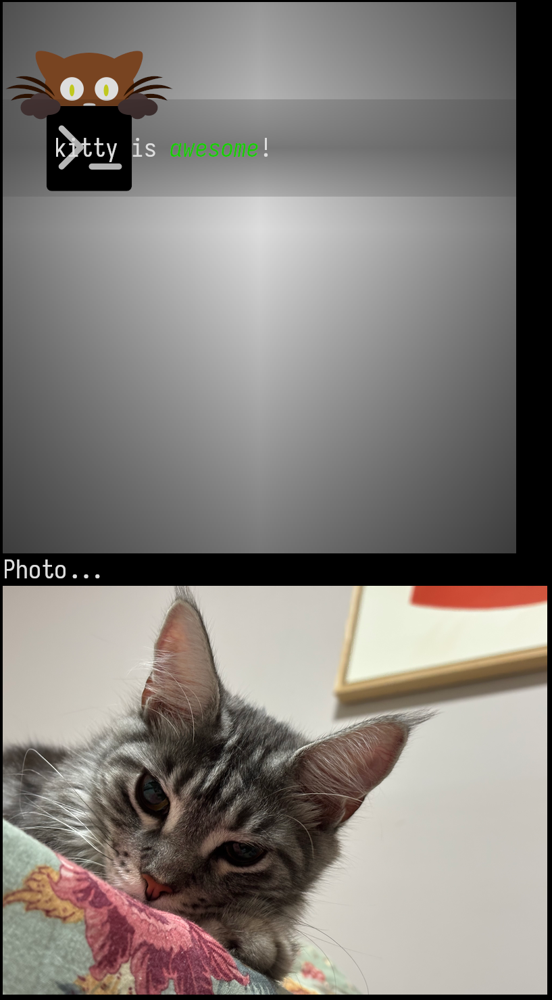
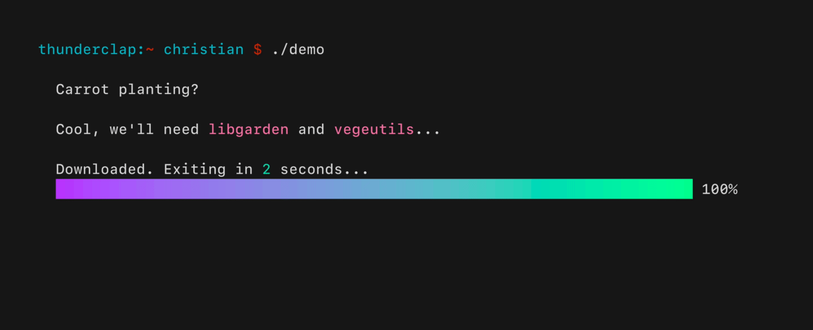
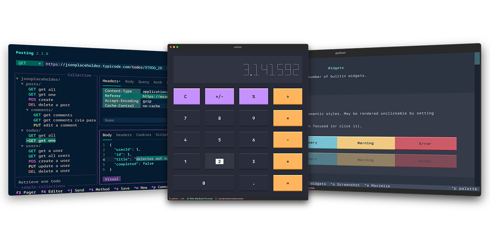
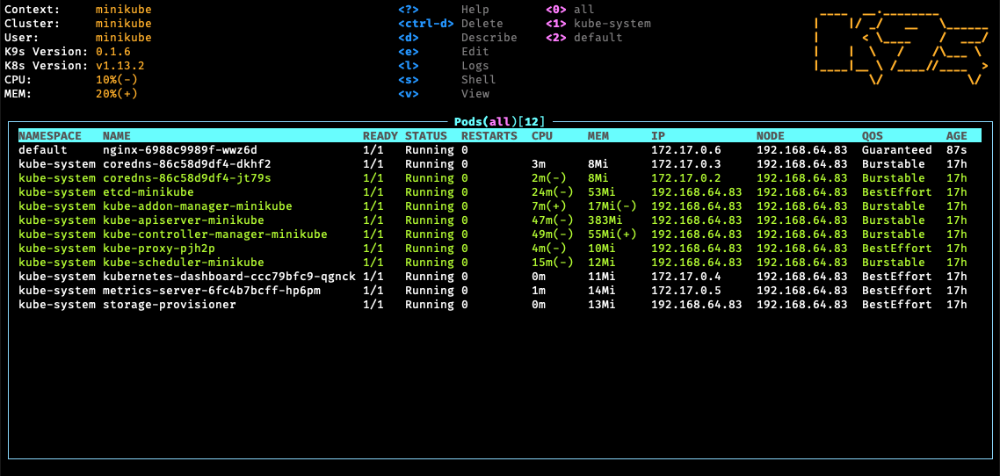
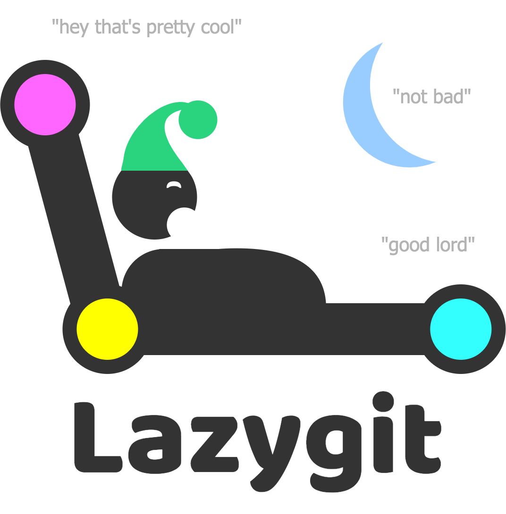
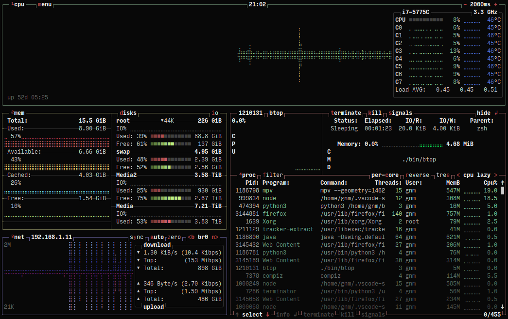
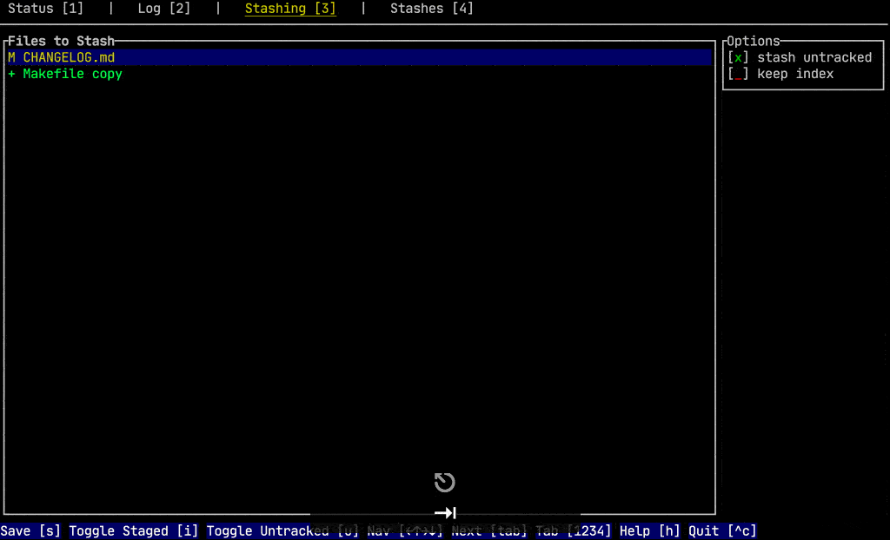
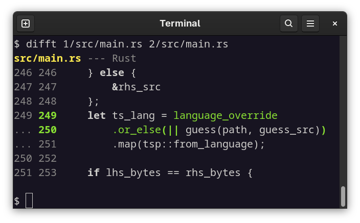
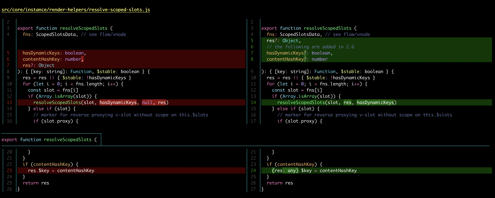

# margin: technical research

*2026-11-05. The terminal and Zellij side of margin: what the screen can show, what reaches it through Zellij, how panes get placed without moving sulin, and how his clicks get back. Product prior art and use cases live in [landscape.md](landscape.md); this file stays on mechanism.*

**Warrant tags.** **[ran]**: I ran it on the development machine (a headless Linux server) and the output is quoted or saved. **[read]**: I read the source or doc at the link. **[inferred]**: my reasoning, not checked. Versions there: Zellij **0.45.1** [ran `zellij --version`]; Ghostty runs on the machine sulin types on, not on the server, which only carries Ghostty's terminfo [read].

**How I tested without a screen.** I ran Zellij sessions headless and attached a fake client inside a pty (`script`, and later a Python pty host that answers terminal queries the way Ghostty does). Everything Zellij drew went to a file; [pyte](https://github.com/selectel/pyte) replayed it into a cell grid, and `docs/tools/termshot.py` turned the grid into an SVG. Mouse input went in as raw SGR escape sequences through the host's stdin. The scripts sit in `docs/tools/`; the test sessions were `margin-test`, `mg-kitty` and `mg-sel`, never one of sulin's.

---

## The answers first

1. **Zellij 0.45 can anchor panes to a tab and leave focus alone from the CLI. No plugin needed.** `zellij action new-pane --tab-id T --no-focus [--floating --pinned true]` creates the pane in tab T while sulin sits on another tab, and the active tab stays put [ran]. `list-panes --json` reports every pane's `tab_id` and title, so "does a pane for this artifact already exist" is one call [ran].
2. **A tiled split via the CLI can't choose its side in another tab.** `--tab-id` with `--direction` returns a pane id but creates nothing (0.45.1) [ran]. Without `--direction`, Zellij puts the pane in the biggest free space, which for a wide chat pane is a split to its right [ran]. Exact placement is the one thing a plugin would add.
3. **Use a pinned float, not a plain float.** A plain float only shows once its tab's floating layer is visible, and with the layer visible, returning to the tab sends keystrokes to the float: a focus steal [ran]. A *pinned* float stays visible with the floating layer hidden, and keystrokes still reach the chat pane [ran, captured below].
4. **Images: the kitty graphics protocol works through Zellij 0.45, placed at the cursor.** Zellij 0.45.0 implemented the protocol itself: it probes the host terminal, parses an app's kitty sequences, stores the image per pane and re-emits it to the host. In my run it rescaled a 4×4 RGB image into an 80×80 RGBA image at its own id [ran]. It refuses unicode placeholders (`U=1`) and shared memory (`t=s`) with `ENOTSUPPORTED` [ran]. Ghostty speaks kitty graphics and has no sixel, so **kitty-at-cursor is the one image path**. Zellij's sixel support is useless here.
5. **Links: make them selection tokens.** Zellij passes OSC 8 through [ran], but a click opens on the machine running Ghostty, which over ssh is the wrong machine [read, inferred]. Zellij's `copy_command` gets the selected text on stdin, and a double-click selects a whole `mg:todo/3` token, colon and slash included [ran]. That makes selection the input that works locally and over ssh alike.
6. **Zellij strips combining characters.** `e` + U+0301 arrived at the host as a bare `e` [ran]. That alone rules out kitty unicode placeholders, which carry row and column in combining diacritics. It also means decomposed Unicode text renders without its accents inside Zellij, so margin should normalise text to NFC before drawing [inferred].
7. **Zellij honours synchronized output (mode 2026)** and batches renders on its own. Ghostty supports 2026 too [read]. A renderer that wraps each frame in 2026 and only writes changed cells won't flicker [inferred].

---

## 1. Zellij control surface (0.45.1)

### What the CLI offers [ran: `zellij action --help` and each subcommand's help]

| need | command | notes |
|---|---|---|
| list panes with their tab | `zellij action list-panes -a -j` | JSON per pane: `id`, `is_plugin`, `title`, `is_floating`, `is_focused`, `is_suppressed`, `exited`, geometry, `tab_id`, `tab_position`, `tab_name` |
| list tabs | `list-tabs -a -j` | stable `tab_id`, `active`, `are_floating_panes_visible`, sizes |
| create a pane | `new-pane [-f] [--pinned true] [-x/-y/--width/--height] --tab-id T --no-focus -n NAME -- CMD` | **prints the new pane id** (`terminal_12`) |
| close, rename, pin by id | `close-pane -p ID`, `rename-pane -p ID`, `toggle-pane-pinned -p ID` | no focus needed |
| move or resize a float | `change-floating-pane-coordinates -p ID -x -y --width --height --pinned` | |
| show or hide floats per tab | `show-floating-panes -t T`, `hide-floating-panes -t T` | exit 0 = changed, 2 = already, 1 = no tab |
| rename a tab (a badge) | `rename-tab-by-id` | covers the tab-badge idea without a plugin [inferred] |
| read a pane's screen | `dump-screen -p ID [--ansi] [--full]` | how the e2e tests can check renders |
| target a session from outside | `zellij -s NAME action …` | |
| stream a pane's rendered output | `zellij subscribe -p ID --format json [--ansi]` | render updates, not pane/tab events; useful for e2e tests [ran `--help`] |
| watch a session read-only | `zellij watch NAME` | a second, non-interactive client [read `--help`] |

Inside any pane Zellij sets `ZELLIJ_PANE_ID` and `ZELLIJ_SESSION_NAME` [ran: `PANE=1 SESSION=margin-test`]. A Bash tool call from Claude Code inherits both, so margin finds its **home tab** by looking up `ZELLIJ_PANE_ID` in `list-panes -j` [inferred from the two facts above]. When the CLI flags landed, per the changelog: `list-panes` JSON and `--tab-id` in 0.44, `--no-focus` in 0.45.0 (PR #5346) [read: [releases](https://github.com/zellij-org/zellij/releases)].

### Placement and focus, tested

The setup: a client attached to session `margin-test` and sitting on tab `other` (id 2), while the "conversation" lives in tab `work` (id 1).

| attempt | result [ran] |
|---|---|
| `new-pane --tab-id 1 --floating --no-focus` | pane created in tab 1, not focused; active tab still `other`; tab 1's floating layer **hidden**, so the float is invisible until shown |
| then `show-floating-panes --tab-id 1` | layer visible, active tab unchanged. But on `go-to-tab-name work`, typed text landed **in the float**: a focus steal on return |
| `new-pane --tab-id 1 --direction right --no-focus` | prints `terminal_4` but **no pane appears**; same with `--direction down` and without `--no-focus` |
| `new-pane --tab-id 1 --no-focus` (tiled, no direction) | split created in tab 1 (the chat pane went from 170 to 85 columns), not focused |
| floating layer hidden, then `new-pane --tab-id 1 --floating --pinned true --no-focus` | pinned float **visible** over the chat; after `go-to-tab-name work`, typed text landed **in the chat pane**; floating layer still reported hidden |

*Checked by capture, not by eye: the fake client's output stream, replayed through pyte, shows the pinned float over the chat and `echo keystrokes still land in the chat pane`, typed after switching to the tab, running in the chat pane's shell.*

**What that settles.** There are two focus-safe shapes: the **pinned float** and the **tiled split in the biggest space**. Plain floats are out, because showing the floating layer turns the next tab switch into a focus steal. The broken `--tab-id --direction` combination looks like a Zellij bug worth reporting upstream [inferred].



### Plugin API, for comparison [read: [plugin commands](https://zellij.dev/documentation/plugin-api-commands.html), [events](https://zellij.dev/documentation/plugin-api-events.html)]

- `open_command_pane_near_plugin` and `open_*_floating_near_plugin` open in the **plugin's** tab "regardless of focus". `open_command_pane_background` opens a hidden pane, and `open_*_in_place_of_pane_id` replaces a pane by id. 0.45 added `new_tiled_pane_in_tab(tab_position)` (default shell only) and `new_tab_unfocused`.
- I found no "command pane in an arbitrary tab, unfocused, on a chosen side" call. The closest is opening near the plugin, then `break_panes_to_tab_with_id(ids, tab_id, false)` [inferred].
- Events: `PaneUpdate(PaneManifest)` covers all panes in all tabs and `TabUpdate(Vec<TabInfo>)` covers tabs. `PaneClosed`, `CommandPaneOpened` and `CommandPaneExited` exist too; all of them need the ReadApplicationState permission.
- Pipes: `zellij pipe --plugin … --name … -- payload` delivers data to a plugin and can stream its replies back on stdout.
- Selections: I found no documented plugin event for "the user selected text". Setups that route selections into a plugin exist, so either they go through `copy_command` too, or they use an API I didn't find [inferred].

---

## 2. Images

### Ghostty [read]
- Ghostty supports kitty graphics with every transmission medium (direct, file, temp file, shared memory), per `src/terminal/kitty/graphics_command.zig` ([source](https://github.com/ghostty-org/ghostty/blob/main/src/terminal/kitty/graphics_command.zig)). The 1.4.0 release notes claim full spec coverage ([notes](https://ghostty.org/docs/install/release-notes/1-4-0)).
- Unicode placeholders are implemented too (`graphics_unicode.zig`, PR #2015; [discussion](https://github.com/ghostty-org/ghostty/discussions/14842)).
- **No sixel**: DA1 doesn't advertise it, and the maintainers prefer kitty ([discussion #2496](https://github.com/ghostty-org/ghostty/discussions/2496)).
- **No iTerm2 inline images**: OSC 1337 `File` is unimplemented in `osc/parsers/iterm2.zig`.

### Zellij 0.45.1 [read: [PR #5428](https://github.com/zellij-org/zellij/pull/5428), [options](https://zellij.dev/documentation/options.html), `zellij-server/src/panes/kitty_graphics/parser.rs`; ran]
- 0.45.0 implemented the kitty graphics protocol "minus the heavier animations and unicode placeholders", with "no need for passthroughs". `support_kitty_graphics_protocol` defaults to true **if the host terminal supports it, checked when Zellij starts**.
- **Probe, observed** [ran]: at client start Zellij sent the host `ESC_G a=q,i=31,s=1,v=1,t=d,f=24`, then DA1, `CSI 14 t` (window pixels), `CSI 16 t` (cell pixels) and a DECRQM for mode 2026.
- **Re-emission, observed** [ran]. A pane printed a 4×4 RGB image (`a=T,f=24,s=4,v=4,c=8,r=4`). Once the pane was visible, the host received:
  ```
  ESC_G a=t,q=2,f=32,t=d,i=2000000000,s=80,v=80,m=1 … (8 chunks)
  ESC_G a=p,q=2,i=2000000000,p=1,x=0,y=0,w=80,h=80,X=0,Y=0,z=0,C=1
  ```
  So Zellij re-encodes the image to RGBA at the cell geometry it probed (8 columns × 10 px = 80) and places it with `C=1`, which keeps the cursor still. In my first test the host never answered the kitty probe; Zellij then **dropped** the image entirely (zero `ESC_G` sequences reached the host). Without Ghostty's reply, nothing gets through.
- **Refusals, observed** [ran]: `U=1` → `ENOTSUPPORTED:unicode placeholders are not supported`; `t=s` → `ENOTSUPPORTED:shared memory transfer is not supported`. These replies are written back **into the pane's input**, so margin's input parser must recognise kitty APC replies and swallow them [ran: the replies showed up echoed in a bash pane].
- **Files**: Zellij reads `t=f` and `t=t` paths itself, on the Zellij host [read: parser.rs]. margin and Zellij always run on the same host, so margin can send a file path instead of base64-encoding the pixels [inferred].
- Not verified: whether Zellij clips an image that a float covers, and what happens on scroll. Both need a look on sulin's real screen.



### What this means for margin
- **Kitty at the cursor**, chunked `t=d` or `t=f`. Detect support with the same `a=q` probe followed by DA1: a kitty reply before the DA1 reply means images will reach the screen [inferred, standard technique].
- **No sixel anywhere.** Ghostty can't show it, and Zellij only advertises sixel when the host supports it ([PR #5432](https://github.com/zellij-org/zellij/releases)).
- **Halfblocks (`▀` with fg/bg colours) only as a last resort**, clearly marked "image: blocks". They cover terminals without kitty support, such as a phone ssh client [inferred].
- **Dead end: injecting into the client tty.** I mapped a Zellij session to its clients' ttys through unix-socket peers (`ss -xp` on the session socket, then `/proc/<pid>/fd`) [ran]. Writing kitty sequences straight to those ttys would bypass Zellij, but the images wouldn't follow pane moves or scrolling, and Zellij 0.45 makes it unnecessary. The same mapping is still useful for OSC 52 clipboard writes (§3).

---

## 3. Links, clicks and selection

- **OSC 8** [ran, read]. Zellij passes OSC 8 through: the host received `ESC]8;;https://example.com/margin`. Zellij has handled OSC 8 since 0.21 ([PR #822](https://github.com/zellij-org/zellij/pull/822)), and 0.44 added `osc8_hyperlinks` for auto-linking URLs it detects itself ([PR #4624](https://github.com/zellij-org/zellij/pull/4624)). Ghostty opens OSC 8 links on ctrl-click (cmd on macOS) through its `open_url` action, on the **machine running Ghostty** ([discussion #12948](https://github.com/ghostty-org/ghostty/discussions/12948)). So `margin://…` would need a scheme handler on the laptop that relays back to the server [inferred]. sulin reports OSC 8 links don't work for him over ssh with Zellij [his words]. Verdict: emit OSC 8 on real URLs as a bonus, never as the action path.
- **`copy_command`** [read: [options](https://zellij.dev/documentation/options.html); ran]. Zellij pipes the copied text to the command's stdin. With `copy_on_select true` (the default), a mouse selection triggers it on release.
  - A drag over `mg:todo/3` delivered exactly `mg:todo/3` [ran].
  - A **double-click** on the token also delivered `mg:todo/3`, because Zellij's word selection kept the `:` and `/` [ran].
  - The command runs as a child of the **Zellij server**: parent `zellij --server …/mg-sel`, stdin a pipe. Its environment comes from the server, `ZELLIJ_SESSION_NAME` included [ran].
  - Setting `copy_command` **replaces** Zellij's OSC 52 clipboard write [read]. So the dispatcher must forward non-token text to the clipboard itself: `wl-copy` when local, otherwise OSC 52 written to each client tty of `$ZELLIJ_SESSION_NAME`. The client ttys come from the socket-peer mapping in §2, which I ran; the OSC 52 write itself I haven't tested [inferred].
- **opener** [read: [superbrothers/opener](https://github.com/superbrothers/opener)]. A daemon on the laptop listens on `~/.opener.sock`. ssh forwards that socket to the remote host (`RemoteForward /home/me/.opener.sock /Users/me/.opener.sock`, plus `StreamLocalBindUnlink yes` in sshd), and a shim `open`/`xdg-open` on the remote end sends the URL into the socket with `nc`. margin's URL opener should be a setting (`xdg-open` locally, `opener` or the shim over ssh), detected from `SSH_CONNECTION` [inferred].
- **Mouse inside the pane** [read: [Zellij changelog](https://github.com/zellij-org/zellij/blob/main/CHANGELOG.md), [Ghostty config](https://ghostty.org/docs/config/reference)]. Zellij forwards SGR mouse events to a pane app that enables mouse reporting (since 0.26). Shift-drag stays native selection in Ghostty (`mouse-shift-capture` defaults to false).
  - **The tension** [inferred]: if margin turns mouse reporting on to get clicks, Zellij hands it the drags as well, and selection, the input that works everywhere, stops working inside margin's pane. Recommendation: keep mouse reporting **off** by default so double-click selection works, and take wheel scrolling through Zellij's scroll path. Mouse mode becomes a per-pane toggle for local use.
  - Not verified: whether the first click into an unfocused pane only focuses it (`mouse_click_through` appears in the docs but not in 0.45.1's default config).

---

## 4. Rendering in a terminal: flicker, animation, Unicode

- **Synchronized output (DEC mode 2026).** Ghostty supports it ([features](https://ghostty.org/docs/features)). Zellij honours it from apps (0.40, [PR #2977](https://github.com/zellij-org/zellij/pull/2977)), emits it to the host (0.39) and answers DECRQM for it. Its own render batching ([#4100](https://github.com/zellij-org/zellij/pull/4100)) already coalesces pane output [read]. I saw Zellij query 2026 from the host at startup [ran].
- **Frame budget** [inferred]. Zellij re-renders to the client on its own cadence, so margin animating faster than about 30 fps buys nothing. Spinners at 8–12 fps, eases over 150–250 ms at 30–60 fps. Idle panes should write nothing at all; that's what keeps margin cheap on a machine that runs other jobs.
- **Damage tracking is the established answer.** Ratatui's `Terminal::flush` "diffs the current buffer against the previous buffer and sends only the changed cells" ([docs](https://docs.rs/ratatui/latest/ratatui/struct.Terminal.html)), and Claude Code's own Ink fork moved to the same model to kill flicker ([write-up](https://steipete.me/posts/2025/signature-flicker)). Ratatui does **not** wrap frames in 2026 itself; crossterm has `BeginSynchronizedUpdate` but leaves it to the app [read].
- **Unicode width** [ran, read]. Width needs grapheme clusters (UAX #29) plus East Asian width (UAX #11), and a Rust renderer gets both from `unicode-segmentation` and `unicode-width`. Zellij dropped a combining accent in my test, so margin should NFC-normalise text and treat any grapheme Zellij might split as a risk to test [inferred].
- **Kitty keyboard protocol.** Progressive enhancement (`CSI > 1 u`) disambiguates keys like ctrl-i and tab. Zellij has supported it since 0.41 [recall, not re-checked]; it matters little for a pane that rarely holds focus.

### Frameworks studied (as references; margin builds its own)

sulin wants to own the UI layer, so these are things to learn from and avoid, not things to depend on.

- **Ratatui 0.30** (Rust): immediate-mode widgets over a double-buffered cell grid. *Learn:* the buffer diff, `Layout` constraints, separating widget state from widget. *Avoid:* immediate mode makes every app rebuild the full frame and carry its own retained state; margin's documents want a retained, keyed tree. Its ecosystem shows what users expect: `tui-tree-widget`, `ratatui-image` (protocol probing, halfblock fallback), `tachyonfx` (post-render cell effects) [read: crates.io, ran via the API 2026-11-05].
- **Bubble Tea v2 / Lip Gloss** (Go): the Elm architecture (model → update → view), with styled strings as the unit. *Learn:* message-driven updates fit "AI patch arrives" and "user ticks" as one event stream. *Avoid:* string-concatenation layout breaks on width edge cases.


- **Textual** (Python): CSS styling, a retained DOM of widgets, reactive attributes, and textual-serve for a web view for free ([textual-serve](https://github.com/Textualize/textual-serve)). *Learn:* the retained widget tree, focus chain, reactive state and the CSS-like layout vocabulary. The web-serving idea also maps onto rendering margin artifacts to a web page later.
- **Ink** (TS/React): React plus Yoga flexbox in the terminal. Claude Code forked it and rewrote the renderer for flicker [read, secondary]. *Learn:* reconciliation by key.
- **notcurses** (C): the most capable pixel and plane compositor, but heavy, and not researched further this pass.



### Dashboards worth borrowing from [recall; screenshots from each project's README]

| | pattern to borrow |
|---|---|
|  | **k9s** ([derailed/k9s](https://github.com/derailed/k9s)): a dense table with a header of live counts, `:` command mode, and a footer of the keys that work *here* |
|  | **lazygit** ([jesseduffield/lazygit](https://github.com/jesseduffield/lazygit)): numbered panels, and the focused list item drives the big pane; `?` gives context help |
|  | **btop** ([aristocratos/btop](https://github.com/aristocratos/btop)): braille and block graphs at sub-cell resolution; boxes toggled by one key; mouse-clickable menus |
|  | **gitui** ([gitui-org/gitui](https://github.com/gitui-org/gitui)): a hint footer that changes with focus; tabs for views |

### Diffs

- **difftastic 0.72** [ran]: `DFT_UNSTABLE=yes difft --display json a b` emits `{aligned_lines:[[l,r]…], chunks:[[{lhs:{line_number,changes:[{start,end,content,highlight}]}, rhs:{…}}…]], language, path, status}`. The changed spans come per token with a syntax class (`keyword`, `string`, `delimiter`, `normal`). The JSON doesn't carry full line text, so margin reads the two files itself [read: [issue #691](https://github.com/Wilfred/difftastic/issues/691)]. `aligned_lines` is exactly what a side-by-side renderer needs, and margin can re-flow it to any pane width without re-running difftastic.
- Colour output (`--color always --display side-by-side-show-both --width N`) also works [ran], but its layout is fixed to the width it was run at, and margin wants to own rendering.
- jj integration: `[ui] diff-formatter = ["difft","--color=always","$left","$right"]` ([difftastic jj docs](https://difftastic.wilfred.me.uk/jj.html)). margin will call difftastic itself, with jj materialising the two sides (`jj file show -r REV PATH`) [inferred].




---

## 5. Claude Code integration points [read: [hooks](https://code.claude.com/docs/en/hooks), [statusline](https://code.claude.com/docs/en/statusline), [MCP](https://code.claude.com/docs/en/mcp), [skills](https://code.claude.com/docs/en/skills)]

- **Hooks** cover 33 events, among them SessionStart, UserPromptSubmit, PreToolUse, PostToolUse, PostToolBatch, Stop, SubagentStart/Stop, Notification, FileChanged and CwdChanged. Every hook receives `session_id`, `transcript_path` and `cwd`; subagent hooks add `agent_id`/`agent_type`. Stop and SubagentStop carry `last_assistant_message`.
- **The session id from a Bash call**: `CLAUDE_CODE_SESSION_ID`, alongside `CLAUDE_PROJECT_DIR` and `CLAUDECODE=1` [ran by a research subagent; undocumented]. Under `--fork-session` it holds the parent's id ([issue](https://claudeissues.com/issue/81304-fork-session-leaves-claude-code-session-id-set-to-the-parent-sessions-id)).
- **Transcripts**: `~/.claude/projects/<cwd-slug>/<session>.jsonl`, with subagents under `<session>/subagents/agent-<id>.jsonl` and a `.meta.json` [ran `ls`]. That's enough to derive an agent monitor without asking the model for anything.
- **Statusline** stdin carries `context_window.used_percentage`, cost and rate limits: data for a context gauge.
- **MCP**: `claude mcp add --scope user margin -- margin mcp` would expose the same operations as typed tools. **Channels** (research preview) let an MCP server push events into a *running* session [read in landscape.md, src 28]. That would deliver sulin's ticks mid-turn instead of at the next prompt.
- **Other hooks**: a `~/.claude/settings.json` that already registers a UserPromptSubmit hook keeps it; margin's unread events arrive through a sibling hook [inferred].

---

## 6. Sources not re-checked

Marked [recall] above. The Zellij kitty-keyboard version is the one that might matter: it changes which keys margin can bind when it does hold focus.

---

## 7. Claude Code hook assumptions, checked (2026-11-05)

Claude Code 2.1.318. Experiments ran in a throwaway dir (`/tmp/claude-1000/margin-hooks.msJW`) with project-local `.claude/settings.json`, `claude -p --model haiku`, one run per question.

**Answers first.**
- **(a) Mid-turn injection works.** A PostToolUse hook that prints `hookSpecificOutput.additionalContext` reaches the model on the next model call of the same turn [ran, read].
- **(b) Queued messages are readable from outside.** The transcript jsonl records each one at the moment sulin types it (`queue-operation` / `enqueue` with the text), then again when it reaches the model (a `queued_command` attachment after the next tool result) [ran]. No hook event covers them [read, inferred].
- **(c) Permission prompts can be answered from outside.** A PermissionRequest hook returns `decision.behavior` allow/deny, and works in `-p` [ran, read]. Notification hooks only observe [read].

### (a) PostToolUse → model, mid-turn

- **Mechanism** [read: [hooks](https://code.claude.com/docs/en/hooks)]. Exit 0 and print `{"hookSpecificOutput":{"hookEventName":"PostToolUse","additionalContext":"…"}}`. The docs put it "next to the tool result" and say "Claude reads the reminder on the next model request, but it doesn't appear as a chat message in the interface."
- **Plain stdout doesn't reach the model** for PostToolUse; only UserPromptSubmit, UserPromptExpansion, SessionStart and PostModelSwitch turn stdout into context [read].
- **Alternatives** [read]: `decision: "block"` + `reason` adds the reason next to the tool result (the tool already ran, so nothing gets blocked). `updatedToolOutput` replaces what Claude sees. Exit 2 shows stderr to Claude. For margin, `additionalContext` is the clean channel; `block` reads as an error.
- **Experiment** [ran]. The hook printed `MARGIN-NONCE-7741: the secret word is periwinkle` after every Bash call. Asked to run `echo hi` and quote any extra context, haiku answered in the same turn:
  > it came as a `PostToolUse:Bash` hook note, not in the command output (which was just `hi`). verbatim: MARGIN-NONCE-7741: the secret word is periwinkle
- **Transcript shape** [ran]: `{"type":"hook_additional_context","content":["MARGIN-NONCE-7741: …"],"hookName":"PostToolUse:Bash","toolUseID":"toolu_…","hookEvent":"PostToolUse"}`, so margin can confirm delivery from the jsonl.
- **Limit** [inferred]: it fires only when a tool call finishes. A turn that's all thinking or one long tool call gets nothing until the call returns. Also, the model treats unsolicited hook text with suspicion: in later runs it noted the nonce, called it irrelevant and "ignored it". margin's injected lines need to say what they are (`margin: sulin ticked plan.t3`) or the model will discount them.
- **Async hooks** [read]: `"async": true` output arrives "on the next conversation turn", not mid-turn. `asyncRewake` with exit 2 wakes an idle session immediately, which is a second route for an event that arrives while Claude is idle.

### (b) Queued user messages

- **Transcript** [ran: read-only grep over 774 recent jsonl files in `~/.claude/projects/`; counts 2074 `enqueue`, 1640 `dequeue`, 432 `remove`, 1529 `queued_command` attachments]. The shape, from one session (message text replaced):
  1. At the moment sulin hits enter: `{"type":"queue-operation","operation":"enqueue","timestamp":"2026-10-07T20:41:38.490Z","content":"run the tests again with the new seed"}`
  2. The running tool call finishes (`tool_result` at 20:41:39.581).
  3. Delivery: `{"type":"attachment","attachment":{"type":"queued_command","prompt":"run the tests again…","origin":{"kind":"human"},"humanTurn":true,…},"rendered":[{"content":"<system-reminder>\nThe user sent a new message while you were working:\n…"}]}`, followed by `{"operation":"remove"}` at 20:41:39.634.
- **So**: `enqueue` with `content` shows a message is waiting; `queued_command` + `remove` show it reached the model, riding alongside the next tool result (~1.1 s later here). A message typed between turns logs `enqueue` and then `dequeue` in the same millisecond and becomes an ordinary user turn [ran].
- **Hooks** [read, inferred]: no hook event fires for a queued message. The docs describe UserPromptSubmit as firing "when a prompt is submitted, before Claude processes it" and say nothing about mid-turn input; I found no UserPromptSubmit `hook_success` entry next to a mid-turn `queued_command` in that session, which has a UserPromptSubmit hook registered. Not tested in a live interactive session.
- **No file besides the transcript** carries them [inferred: none documented].

### (c) Answering permission prompts from outside

- **PermissionRequest hook** [read: [hooks](https://code.claude.com/docs/en/hooks#permissionrequest)]. Input: `tool_name`, `tool_input`, `permission_suggestions`. Output: `hookSpecificOutput.decision` with `behavior` (`allow`/`deny`), `updatedInput` and `updatedPermissions` for allow, `message` and `interrupt` for deny. Deny rules still win over a hook's allow. Exit 2 is ignored; a hook failure denies.
- **Headless** [read]: "In sessions that can't show a prompt … Claude Code still runs these hooks, and if no hook returns a decision, it denies the tool call. For a call that reaches a `--permission-prompt-tool` or the Agent SDK's `canUseTool` callback, the hooks run alongside your host, and whichever decides first applies."
- **Experiment** [ran]. A hook that denied any command containing `touch` (message `MARGIN-DENY-3302`) and allowed everything else:
  - `touch marker.txt` → model reported `MARGIN-DENY-3302: denied by the margin hook`; no file created.
  - `mkdir allowed-dir` (no `--allowedTools`, which `-p` would otherwise deny) → the hook allowed it; the directory exists.
  - `pwd` never reached the hook: read-only commands skip the prompt, so the hook sees only calls that would really prompt.
- **Notification hook** [read]: matcher `permission_prompt` fires with `message`/`title`, but "Notification hooks can't block or modify notifications", so it can tell margin that a prompt is open but can't answer it.
- **Elicitation hook** [read]: MCP elicitation dialogs can be answered by a hook (`action: accept/decline/cancel`), which is the same pattern for MCP questions.
- **Remote control** [inferred]: Claude Code's remote control already lets the Claude app answer prompts; that path belongs to the app, not to margin.
- **Not verified**: whether the terminal dialog appears while a PermissionRequest hook is still waiting, and what happens if sulin answers in the terminal first. The docs only describe the "whichever decides first" race for `--permission-prompt-tool`/SDK. Hook timeouts are configurable per hook (`timeout`, seconds); the docs show a 600 s default in one place [read], but I didn't confirm the default for a sync PermissionRequest hook, so set `timeout` explicitly.

### What this means for margin's design (design.md §2)

- **Mid-turn delivery moves up from "later".** The PostToolUse fallback works today with no channels preview: a sync PostToolUse hook runs `margin events --unread --brief` and prints the result as `additionalContext`, empty when nothing happened. It costs one fast process per tool call, so `margin events` must stay well under 50 ms [inferred]. Keep the UserPromptSubmit hook for turns without tool calls. Prefix every line with `margin:` so the model doesn't take it for a prompt injection.
- **The queue card can be built.** margin tails the session jsonl (`transcript_path`), shows a card on `enqueue`, and marks it delivered on the matching `queued_command`/`remove`. It reads only: I found no documented way for an outside process to edit or withdraw a queued message [inferred].
- **The agent monitor can answer prompts.** A PermissionRequest hook (`margin permit`) posts the request to margin, blocks until sulin clicks allow/deny (or a timeout falls through to the normal dialog by printing nothing), and returns `decision`. Test the terminal-dialog race interactively before relying on it. A Notification `permission_prompt` hook is enough to light the monitor up, but not to answer.

---

## 8. What building v0 settled (2026-11-05)

Measured with the v0 binary in throwaway headless Zellij 0.45.1 sessions driven by `tests/e2e/ptyhost.py`. Every check below is in `tests/e2e/run.py` (25/25 pass) or `tests/e2e/idle.py`.

- **A click on an unfocused pane only focuses it** [ran]. A double-click on a token in an unfocused pane selects nothing; one focusing click first, then the double-click, works. This answers §3's open question.
- **`mouse_click_through true` fixes it for splits, not for pinned floats** [ran]. With the option, a double-click on a token in an unfocused **split** reaches `margin select` in one gesture. A **pinned float with the floating layer hidden** still eats the first click. So v0's default pane is a split, and `margin session` sets `--mouse-click-through true` for its own session only.
- **Session-only options work from the CLI** [ran]: `zellij -s NAME -n LAYOUT options --copy-command "margin select" --copy-on-select true --mouse-click-through true` applies to that session and leaves `config.kdl` alone. Gotcha: `-s NAME --layout L` adds tabs to an existing session; a new session with a layout needs `-n` [ran].
- **Kitty images reach the host from margin's real output** [ran]. margin probes (`a=q` + DA1) through Zellij, gets `OK`, and sends RGBA `f=32` at the cursor. Zellij re-emits it to the host as `a=t` chunks plus `a=p,…,w=470,h=200,C=1`. The fake client decodes those bytes and composites them, so the test's capture shows what Zellij actually sent.
- **OSC 52 pass-through works** [ran]: `margin select` maps the session socket's peers to client ttys with `ss -xp`. A double-clicked plain word (`runs`) arrived at the client as `ESC]52;c;cnVucw==`. This closes §3's untested step.
- **Focus-safety holds** [ran]: `margin open --float` from the chat pane's env while sulin sits on another tab keeps the active tab, keeps the chat pane focused, and typed text lands in the chat. `margin open` (split) also opens unfocused.
- **Idle costs nothing** [ran, `tests/e2e/idle.py`, debug build]. A settled pane with motion off wrote **0 bytes and used 0.000 s CPU in 5 s**. A pane under a minute old ticks its "3s ago" label once a second: 195 bytes in 3 s, no measurable CPU. The focused, flowing gradient ring costs **0.040 s CPU per 3 s** (about 1.3% of a core) and about 43 KB/s of output to Zellij, and only while the pane holds focus.
- **Test-harness limits, not product limits** [ran]: pyte ignores SGR colon sub-parameters (`4:4` dotted underline, `58:2::r:g:b`) and applies only the first extended colour per sequence. `tests/e2e/sgrfix.py` rewrites both for pyte only. Ghostty handles both natively; whether Zellij forwards `4:4` unchanged to Ghostty still needs sulin's screen.

---

## 9. What building feeds and the host split settled (2026-11-06)

Measured with the debug binary; every check is in `tests/e2e/feeds.py` (28/28 pass), `tests/e2e/run.py` (25/25 still pass after the host split) or the unit tests (20).

- **Hooks stay fast under a busy feed** [ran]. With one feed writing 20 revisions a second, 40 calls each of `margin hook prompt` and `margin hook post-tool`, every call a new session (so each reads and describes every unread event): prompt median 2.2 ms, p95 4.4 ms, max 8.9 ms; post-tool median 2.5 ms, max 8.2 ms. Both still handed over sulin's pick. The hooks take no lock and never touch the daemon.
- **An unbounded stream channel starves the worker** [ran, then fixed]. A feed printing in a tight loop kept the worker draining its channel forever: it never wrote, never saw its stop flag, and the daemon hung joining it. Now the channel is bounded (the process blocks on its own stdout: backpressure), a drain takes at most 512 lines per pass, and replaces of the same id coalesce.
- **Removed sections never left the live pane** [ran, then fixed]. Pre-existing in `scene.rs`, exposed by feeds rewriting structure: the draw loop called `retained.place()` for ghost rows, which re-created their nodes as present, so the collapse never finished; sibling ghosts also inserted in reverse. `scene::tests::removed_section_and_children_leave` fails without the fix [ran].
- **A jj feed must not record jj operations** [inferred from jj's model, then designed around]. Any jj command without `--ignore-working-copy` may snapshot the working copy, which records an operation, which changes `op_heads`, which retriggers a watch on `op_heads`. The jj feed reads with `--ignore-working-copy`; the cost is that unsnapshotted edits show at the next jj command.
- **Transcripts can't separate a slow tool from a permission prompt** [read: transcript entries in §7]. A pending `tool_use` without its `tool_result` looks the same in both cases. The agents feed marks a call pending over 60 s as "still running, or waiting on a permission prompt". A Notification hook (`permission_prompt`) would make it exact.
- **Plain host: SIGTERM must restore the terminal** [ran]. `margin close` on the plain host signals the `margin view` process; vellum now turns SIGTERM and SIGHUP into a clean exit (self-pipe wakes `poll`, `Drop` restores raw mode and the alt screen). The e2e test clicks a token with mouse reporting on, which the plain host enables by default.
